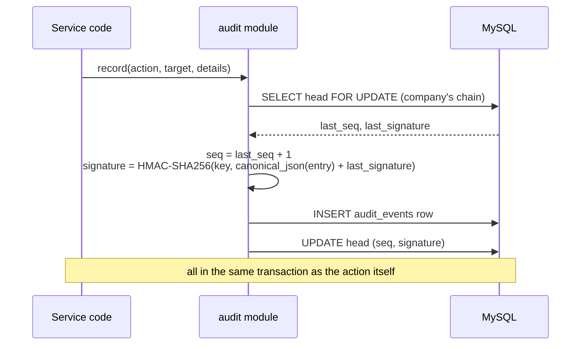

# Audit log

**In short:** every security-relevant action (sign-ins, permission changes, approvals, schedule changes, automatic expirations) is written to a log that cannot be quietly edited. Each entry is linked to the previous one and signed with a secret key that is kept outside the database, so any change, removal, or insertion is detected when the log is checked.

Decision: [0018](https://github.com/workforce-ops-app/.github/blob/main/docs/decisions/0018-audit-log-chains.md).

> **Status:** writing is built (`app/audit/`, migration `0003`, slice L1), and so is verification (`app/audit/verify.py`, `POST /api/audit/verify`, and the nightly `scripts/verify_audit_log.py`, #58, pulled forward from Phase 4). The viewer follows in the next tier; insert-only database rights in T2 (#43).

## How an entry is written



- The entry is written **in the same transaction** as the action it records, so an action cannot succeed without its audit entry (and vice versa).
- Each company has its own chain. Actions by platform personnel go to a separate platform chain.
- Automatic actions use actor `system`.

## Recording an action

```python
from app.audit import Actor, record

record(
    session,
    actor=Actor.user(user_id),
    action="shift.assigned",
    target_type="shift",
    target_id=shift.id,
    details={"employee_id": str(employee_id)},
)
```

| Rule | Why |
|---|---|
| Call it in the **same session** as the action, before the caller commits; `record()` never commits | the action and its entry are saved together or not at all |
| The chain is the **session's company** (`app/tenancy/context.py`); there is no company or chain parameter | one company's actions can never be written into another company's log. A session with no company (platform code) writes to the platform chain; a person's action (`Actor.user`) is refused there |
| `action` is a dotted lowercase name, such as `shift.assigned` | consistent names for the viewer and the detection study |
| `details` holds text, whole numbers, true/false, null, lists, and objects. Keys containing `password`, `token`, `secret`, or `hash` are refused at any depth, and so are decimal numbers and whole numbers beyond 64 bits | the log is kept forever, so it must never hold credentials; MySQL may write such numbers back differently, which would change the signed bytes |
| Without `AUDIT_SIGNING_KEY`, `record()` raises `AuditError` | no unsigned entries: the action fails with it |
| A chain's first entry creates its head | companies need no setup step. If two first entries ever raced, the head's primary key lets only one create it; the other transaction fails and rolls back |

Each feature page lists the audit events its actions write; every slice from L1 on records them.

| Part | Where | What it does |
|---|---|---|
| Tables | `app/audit/models.py`, migration `0003` | `AuditChainHead` and `AuditEvent`, as on the [data model](data-model.md#audit_chain_heads) |
| Signing | `app/audit/signing.py` | `canonical_json(event)` and `sign(key, event, prev_signature)`; verification (#58) reuses them |
| Writing | `app/audit/record.py` | `record()` and `Actor`: checks, locks the head, numbers, signs, and adds the entry |
| Verification | `app/audit/verify.py`, `app/modules/audit_log/` | `verify_chain()` checks one chain; the endpoint and the nightly check decide which chain and record the result |
| Settings | `app/core/config.py` | `AUDIT_SIGNING_KEY` (at least 32 characters), `AUDIT_KEY_ID`, and `AUDIT_PREVIOUS_KEYS` (older keys, for verification only) |
| Tests | `tests/unit/test_audit_record.py`, `tests/security/test_audit_log.py`, `tests/unit/test_audit_verify.py`, `tests/security/test_audit_verify.py` | numbering, links, signatures, rollback; tampering, forgery without the key, secrets in details, and crossing companies; verification finding edited, removed, inserted, and cut-off entries |

The audit tables are not `CompanyOwned` (the platform chain has no company), so the tenancy coverage test lists them as a stated exception (the detection design adds `platform_security_events` as the second, [detection](../features/detection.md#data-two-tables)). Two consequences for later slices:
- **Reading is not filtered by company.** A query on `AuditEvent` in a company's session would see every company's entries. So every read limits itself to one chain: verification reads only the session's company's chain (`app/modules/audit_log/service.py`, never a chain ID from the request), and the viewer must do the same.
- **Details are checked by key name only.** `{"password": ...}` is refused, but a value that happens to contain a secret cannot be recognized, so callers never put credentials into details at all.

## What an entry contains

| Field | Notes |
|---|---|
| `seq` | 1, 2, 3… per chain, no gaps; `(chain_id, seq)` is a unique key |
| `chain_id` | which log: the company's ID, or the all-zero UUID for the platform chain |
| `company_id` | null for the platform chain |
| `actor_type`, `actor_id` | `user`, `platform_user`, or `system` (no ID for `system`) |
| `action` | dotted name, e.g. `time_off.approved`, `role.permission_added` |
| `target_type`, `target_id` | what was acted on |
| `occurred_at` | UTC |
| `details` | JSON: before/after values where useful. No passwords, tokens, or secrets |
| `key_id` | which signing key was used |
| `prev_signature`, `signature` | the chain links |

**Canonical JSON:** the signed bytes are the entry's fields as JSON with sorted keys, no extra whitespace, UTF-8, and timestamps in one fixed format, so verification always recomputes identical bytes.

## Verification

`verify_chain()` (`app/audit/verify.py`) reads one chain from its first entry and checks, for each entry: the numbering (1, 2, 3, no gaps), the link (its `prev_signature` is the signature of the entry before), and the signature (recomputed with the key named by the entry's `key_id`, compared in constant time). The first problem stops the check.

- **The end of the chain:** after checking every entry, verification compares the last entry it found with the chain head: its `seq` must equal `last_seq` and its signature must equal `last_signature`. Each entry only vouches for the one before it, so deleting the newest entries leaves a chain that still checks out entry by entry; only the head shows that it used to be longer. An entry past the head, or entries without a head, fail too.
- **While someone writes:** the head is read first and the entries after it, in one transaction, so on MySQL (REPEATABLE READ) both come from the same snapshot. `record()` moves the head in the same transaction as it adds an entry, so an entry being added during a check is either fully seen or not at all.
- **On demand:** `POST /api/audit/verify` checks the signed-in person's own company's chain and returns `ok`, `checked`, `last_seq`, `first_bad_seq`, and `problem`. It needs `audit.verify` (Owner and Administrator, [authorization](authorization.md#starting-roles)) and the CSRF token. There is no chain parameter: the chain is always the session's company's.
- **Nightly:** `python -m scripts.verify_audit_log` checks every chain from the start (no checkpoints yet). There is no job runner yet, so it is scheduled on the host like `scripts/remove_old_security_events.py`; the script's text shows the cron command. It exits with 1 when any chain failed.
- **Outside copy:** the nightly check writes each chain's head (`chain_id`, `last_seq`, `last_signature`) to the application log as one JSON line ("audit chain head"). Keep those lines outside the database: if the whole database is put back to an older state (entries and head together), the head copied on an earlier night is further along than the one in the database. Comparing them is done by hand for now.
- **Every check is recorded** in the chain it checked, as `audit.verified` (actor the person, or `system` at night) with the result. Recording links to the head as usual, so it never repairs a broken chain: the next check still finds the damage.
- **Older keys:** after the key is rotated, the old keys go in `AUDIT_PREVIOUS_KEYS` (JSON, by key ID); they are used for checking only, never for signing. An entry whose key is not available fails the check instead of being skipped. When rotating, add `AUDIT_PREVIOUS_KEYS` to the api service's environment in `docker-compose.yml` as well.

A verification failure names the first bad `seq` (or, when the end is missing, the `seq` the head expected) and raises a security event (`audit.chain_broken`): on demand in the company's own security events, naming the person who ran the check; at night in the platform's security events, which name no company (rule DE9 in [detection](../features/detection.md)), with the chain in the application log's error line.

## Protection in the database

| Database user | Audit tables |
|---|---|
| application | `INSERT`, `SELECT` on `audit_events`; `INSERT`, `SELECT`, `UPDATE` on `audit_chain_heads` (a chain's first entry creates its head). Never `DELETE` on either |
| migrations | schema changes only, not used by the running application |

These rights arrive with T2 (#43). Until then the application's database user can change rows directly; the signatures make any such change detectable.

## The signing key

- Provided through the environment or a secret store (`AUDIT_SIGNING_KEY`, with its ID in `AUDIT_KEY_ID`), **never** stored in the database or the repository. Locally it goes in `.env`; generate one with `python -c "import secrets; print(secrets.token_urlsafe(32))"`.
- Has an ID; rotating the key starts using a new ID while old entries keep theirs. Old keys are kept (read-only) for verification, in `AUDIT_PREVIOUS_KEYS`.
- Losing a key means entries signed with it can no longer be verified; leaking it reduces the protection to a plain hash chain. Its handling will be covered by an operations runbook.

## Why a signed hash chain

**In short:** each entry is linked to the one before it, so changing history breaks the chain, and each link is signed with a secret key, so nobody without the key can repair a broken chain. The accurate name is an **HMAC-signed hash chain**, or a tamper-evident log.

**How the links work:** every entry stores the previous entry's signature, and its own signature covers that value. Editing, removing, or inserting an entry therefore invalidates every entry after it.

**Why a secret key instead of a plain hash:** with a plain hash chain, anyone with database access could change an entry and recompute every hash after it, leaving a chain that still looks valid. Without the key they cannot produce valid signatures. Only whoever holds the key (the verification job, and owners through it) can verify the chain.

**Wording for reports:** describe it as a "tamper-evident, HMAC-signed hash chain".

## What to log

Log actions that change access, data belonging to others, or configuration: authentication events, role and permission changes, scope changes, approvals and denials, schedule changes, policy changes, support access, and automatic actions. Feature pages list their audit events.
