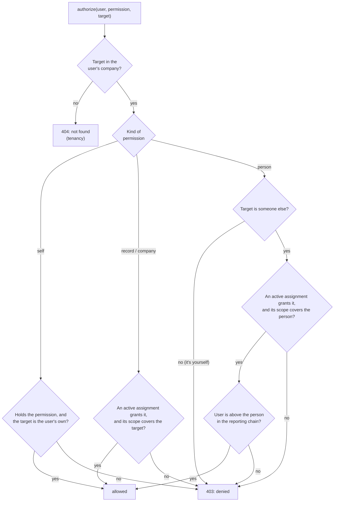

# Authorization

**In short:** every action in the application is a named **permission**, and **roles** bundle permissions. When someone is given a role, the assignment says **where** it applies: the whole company, a department, a team, or one employee. For actions on a person (changing their roles, reviewing their requests, resetting their password), the user must also be **above that person in the reporting chain**. Everything is denied unless a rule allows it, and nobody can change their own access. Access is handed down from the owner one layer at a time: each person passes on at most what they hold, only to people below them.

Decisions: [0017 scoped role assignments](https://github.com/workforce-ops-app/.github/blob/main/docs/decisions/0017-scoped-role-assignments.md) · [0024 authorization model](https://github.com/workforce-ops-app/.github/blob/main/docs/decisions/0024-authorization-model.md) · [0025 sensitive actions](https://github.com/workforce-ops-app/.github/blob/main/docs/decisions/0025-sensitive-actions-and-security-settings.md) · [0029 approval routing](https://github.com/workforce-ops-app/.github/blob/main/docs/decisions/0029-request-approval-routing.md) · [0032 delegation limits](https://github.com/workforce-ops-app/.github/blob/main/docs/decisions/0032-delegation-limits.md)

> **Status:** permissions, roles, assignments, `authorize()`, scope resolvers, and the list filter are built (`app/authz/`, migration `0005`, slice Z1), and so is the reporting chain (`app/authz/chain.py`, migration `0007`, slice Z2): person permissions work for anyone above the person. The role, role-assignment, and approval-request endpoints are built (slice Z4: [role endpoints](#role-endpoints), [approval requests](#approval-request-endpoints)); a role at the giver's own level opens an approval request (`app/approvals/`, migration `0011`) that the manager above decides. Reporting lines can be added and ended through the API (`app/modules/reporting_lines/`), and owners added and removed with the other owners' agreement (`app/modules/owners/`), slice Z5.

## The two questions every check answers

| Question | Answered by | Example |
|---|---|---|
| **What** may this user do? | the permissions in the roles they hold | a Manager role grants `schedule.edit` |
| **Where**, or **on whom**? | for records: the scope of the role assignment; for people: the reporting chain | the Manager role is assigned for the Kitchen department, so they may edit Kitchen shifts; they may review Sam's time off only if they are above Sam |

Company separation comes first and is a different mechanism ([tenancy](tenancy.md)): another company's records do not exist for the user (404). Authorization then decides what is allowed **inside** the user's company (403 when not allowed).

## Permissions

**Naming:** `resource.action`, lowercase. A permission's name and kind agree both ways ([0024](https://github.com/workforce-ops-app/.github/blob/main/docs/decisions/0024-authorization-model.md)): a name ending in `_self` is always a self permission and only ever applies to the user's own records, and every self permission ends in `_self` (for example `time_off.request_self`). The registry refuses a permission that breaks either rule, so the API does not start. Each module declares its permissions in its `permissions.py`, and the registry collects them ([extension points](https://github.com/workforce-ops-app/.github/blob/main/docs/decisions/0012-extensibility-patterns.md)). `sync_permissions()` copies the registry into the `permissions` table. It runs when a company's starting roles are created, and the role-management service (Z4) calls it in the same transaction before it checks or adds a role's grants, so a permission added by a new module can be granted by existing companies without reseeding.

**Kinds of permission**, which decide how a check works:

| Kind | Applies to | Checked with |
|---|---|---|
| **Self** | the user's own records | the record belongs to the user |
| **Record** | shifts, requests, and other records | the assignment's scope covers the record |
| **Person** | another person: their roles, account, or requests | the assignment's scope covers the person **and** the user is above them in the reporting chain |
| **Company** | company-wide settings and structure | an assignment with company scope |

**Core permissions** (later features add their own):

| Permission | Kind | Allows |
|---|---|---|
| `schedule.view_self` | self | see your own shifts |
| `schedule.view` | record | see shifts in scope, including open shifts |
| `schedule.edit` | record | create, change, and cancel shifts in scope |
| `time_off.request_self` | self | ask for time off for yourself |
| `time_off.cancel_self` | self | cancel your own pending or approved request |
| `time_off.view` | record | see time-off requests of people in scope |
| `time_off.review` | person | approve or deny the requests of people you are above ([0029](https://github.com/workforce-ops-app/.github/blob/main/docs/decisions/0029-request-approval-routing.md)) |
| `user.view` | record | see people in scope (name, department, teams, roles) |
| `user.manage` | person | create accounts, issue setup and reset links, deactivate, unlock, sign out; approve other people's requests to change their own name or email |
| `account.change_self` | self | ask to change your own display name or email; takes effect once approved from above ([0032](https://github.com/workforce-ops-app/.github/blob/main/docs/decisions/0032-delegation-limits.md)) |
| `org.manage` | company | create, rename, and archive departments and teams; move people between them |
| `role.view` | company | see roles and what they grant |
| `role.manage` | company | create roles; change, rename, or archive a role whose holders are all below you ([delegation limits](#delegation-limits)) |
| `role.assign` | person | give or remove a role, with its scope, for people you are above; a role at your own level needs approval from above |
| `reporting_line.manage` | person | add or end reporting lines between two people you are both above |
| `settings.manage` | company | change company settings, including security settings |
| `audit.view` | company | read the company's audit log |
| `audit.verify` | company | run verification of the company's audit chain |
| `security.view` | company | see the company's security events on the security page (built, DT5: [detection](../features/detection.md#backend)) |
| `announcement.create` | record | post, edit, and archive announcements for an audience in scope; see who has read them ([announcements](../features/announcements.md)) |
| `coverage.request_self` | self | ask coworkers to cover or swap one of your own shifts; cancel your request ([coverage](../features/coverage.md)) |
| `coverage.respond_self` | self | answer a coverage request you were asked about: accept, swap, or decline |
| `coverage.review` | person | approve or deny the coverage requests of people you are above; approving also needs `schedule.edit` on every shift that changes ([0029](https://github.com/workforce-ops-app/.github/blob/main/docs/decisions/0029-request-approval-routing.md)) |
| `company.transfer_ownership` | company | propose adding or removing an owner (Owner role only; other owners must agree) |

Changing your own password and signing yourself out need no permission; every signed-in user can do both.

## Starting roles

Every new company gets four roles ([0024](https://github.com/workforce-ops-app/.github/blob/main/docs/decisions/0024-authorization-model.md)). Companies may edit all but Owner, and may add their own roles.

| Permission | Owner | Administrator | Manager | Employee |
|---|:---:|:---:|:---:|:---:|
| `schedule.view_self` | yes | yes | yes | yes |
| `schedule.view` | yes | yes | yes | yes (see below) |
| `schedule.edit` | yes | yes | yes | |
| `time_off.request_self`, `time_off.cancel_self` | yes | yes | yes | yes |
| `time_off.view`, `time_off.review` | yes | yes | yes | |
| `user.view` | yes | yes | yes | |
| `account.change_self` | yes | yes | yes | yes |
| `user.manage` | yes | yes | | |
| `org.manage` | yes | yes | | |
| `role.view` | yes | yes | | |
| `role.manage`, `role.assign` | yes | yes | | |
| `reporting_line.manage` | yes | yes | | |
| `settings.manage` | yes | yes | | |
| `audit.view`, `audit.verify` | yes | yes | | |
| `security.view` | yes | yes | | |
| `announcement.create` | yes | yes | yes | |
| `coverage.request_self`, `coverage.respond_self` | yes | yes | yes | yes |
| `coverage.review` | yes | yes | yes | |
| `company.transfer_ownership` | yes | | | |

- **Typical scopes:** Owner and Administrator are assigned for the whole company; a Manager for their department or team; everyone gets the Employee role scoped to their **home department**, which is what lets employees see their department's schedule. An administrator can remove `schedule.view` from the Employee role to turn that off.
- **Owner** is locked: its permissions cannot be changed, and it is always assigned for the whole company. An active, company-wide Owner assignment grants **every** registered permission, including ones a module adds after the company's roles were created, and for the whole company even when another of the owner's roles grants the same permission more narrowly; the Owner role's `role_permissions` rows are only a record of that. A company has at least one owner and may have several true co-owners; leaders who are not co-owners (such as a board of directors) get their own role below the owner.
- Later features add to these roles; for example employees do not get `announcement.create` by default.
- **Companies that already exist** get a new starting-role permission from the migration that adds the feature, not only new companies: the starting roles of a company are filled with the permissions known when it was created, so the migration adds the new grant to every existing company's matching starting roles (only where it is missing; company-made roles are left alone). `0014_announcements` does this for `announcement.create` (Owner, Administrator, Manager) and `0015_coverage_offers` for `coverage.respond_self`. `scripts/check_migrations.py` upgrades a company made before 0014 and checks a manager can post afterwards.

## How a check works

`authorize(user, permission, target)` is called by every service function before it does anything.



**Scope coverage** ([0017](https://github.com/workforce-ops-app/.github/blob/main/docs/decisions/0017-scoped-role-assignments.md)):

| Assignment scope | Covers |
|---|---|
| company | everything in the company |
| department | the department, its teams (as records), the people whose home department it is, and their records. Not a member of one of its teams whose home is another department: authority over that person needs a team-scoped assignment, so team membership never quietly widens a department manager's reach |
| team | the team's members and their records |
| employee | that one person and their records |

Archived roles and deactivated users grant nothing, and neither does an assignment for an archived department or team: the assignment stays for history, but its scope covers nothing ([organization](../features/organization.md#states-and-rules)). Permissions are read on every request, so a change to someone's roles takes effect immediately.

**In the code** (`app/authz/check.py`): `authorize(db, user, permission, target)` returns when allowed and raises `Forbidden` (403) or `NotFound` (404, a target of another company). Without a target, a record or person check asks "anywhere at all?", which is what a list endpoint checks before applying the scope filter; company and self checks work the same with or without one. An unknown permission code is a bug and raises `LookupError` instead of answering yes or no. "Above" means the Owner, or above the person through reporting lines ([the reporting chain](#the-reporting-chain)).

### Scope resolvers

`authorize()` does not know what a shift or a request is. Each module registers a **scope resolver** (`@scope_resolver(Shift)`, `app/authz/scope.py`) that answers, for one of its records: which department, which team(s), and which employee does it belong to? For a shift: its `department_id` and its `employee_id` (none while open). For a time-off request: its employee, and through them their home department and teams.

### Lists: the scope filter

Checking each row one by one would be slow and easy to forget. For lists, the `authz` layer turns the user's assignments for a permission into a **database condition** that the repository adds to its query, for example "shifts whose department is Kitchen, or whose employee is on the Weekend Crew team". Rows outside scope are never loaded.

```python
query.where(
    scope_filter(
        db, user, "user.view", ScopeColumns(department=User.department_id, employee=User.id)
    )
)
```

The filter follows exactly the rules of `authorize()` for each kind: self permissions list the user's own rows; company permissions list everything, but only with a company-wide assignment; person permissions list only people the user is above, never the user. A department's people and a team's members are looked up first (in the company's session, so the company filter applies), and the condition names their IDs; so are the people below the user in the reporting chain, for the same reason (the company filter does not accept a recursive query nested inside a query on another table). Security tests check that the filter and `authorize()` agree for every pair of people, for a record permission and two person permissions, and again along a chain with several levels, two managers, and peers (`tests/security/test_reporting_chain.py`).

`ScopeColumns` names a department column, an employee column, and an optional `team` column, used by announcements, whose audience can be a team (built, AN1 in [announcements](../features/announcements.md#backend)): a team assignment then also matches its team's rows, and a department assignment the rows of its active teams, with the team IDs looked up first like a department's people. An archived team's rows are left to company-wide assignments, as the announcement's scope resolver says. Tables without a team column (people, shifts) keep exactly their conditions. Scope tests check that the managed announcements list and `authorize()` agree for every pair of an assignment (company, each department, each team) and an audience (company, each department, a team in each department), also after a team or department is archived (`tests/security/test_announcements.py`).

## The reporting chain

A `reporting_lines` row says that one person reports to another ([data model](data-model.md#reporting_lines)). Following the lines upwards gives everyone a person is **below**; the **Owner counts as above everyone**.

**Being above someone grants nothing by itself.** It decides *whom* you may act on; your permissions decide *what* you may do. Only **person** permissions use it.

**Finding out whether A is above B** walks the lines upwards from B with a recursive query. In SQL it looks like this (the code builds it with SQLAlchemy's `cte(recursive=True)`, never as a hand-written string, per [0022](https://github.com/workforce-ops-app/.github/blob/main/docs/decisions/0022-sqlalchemy-and-alembic.md)):

```sql
WITH RECURSIVE above_b (manager_id) AS (
    SELECT manager_id FROM reporting_lines
     WHERE employee_id = :b AND company_id = :company AND ended_at IS NULL
    UNION
    SELECT r.manager_id FROM reporting_lines r
      JOIN above_b a ON r.employee_id = a.manager_id
     WHERE r.company_id = :company AND r.ended_at IS NULL
)
SELECT 1 FROM above_b WHERE manager_id = :a;
```

The first `SELECT` finds B's direct managers; the second repeatedly joins "the managers of the people found so far". `UNION` (not `UNION ALL`) drops duplicates, so the walk also stops if a loop ever slipped in.

In the code (`app/authz/chain.py`) the last line reads the `reporting_lines` model instead ("A manages B, or manages someone above B"), because the company filter only accepts a query whose outer `SELECT` names a model it knows. It then adds `company_id = :company` to the start, to every step, and to the outer `SELECT`, as above. The same walk downwards gives everyone below a person, which the list filter uses.

**Ended lines** do not count. **Deactivated people stay in the chain:** a deactivated manager holds no permissions, so they can act on nobody, but the people above them stay above the people below them. Otherwise deactivating one manager would leave their reports manageable only by the Owner.

**Rules for reporting lines** ([0024](https://github.com/workforce-ops-app/.github/blob/main/docs/decisions/0024-authorization-model.md)):
- Adding or ending a line needs `reporting_line.manage` and a position above **both** people. The Owner can always do it.
- Nobody adds or ends a line they are part of.
- A line may not create a loop: the new manager must not already be below the employee. Nobody reports to themselves.
- Only one current line per manager and employee pair.
- Adding or ending a line needs the password re-entered and is audited.

**Endpoints** (`app/modules/reporting_lines/`):

| Endpoint | Needs | What it does |
|---|---|---|
| `GET /api/reporting-lines?user_id=[&include_ended=true]` | your own, or `user.view` covering the person | the lines a person is part of, as manager or employee |
| `POST /api/reporting-lines` `{manager_id, employee_id}` | `reporting_line.manage` over both people (never yourself: AZ2), above both (AZ6), password re-entry | add a line; 409 for a loop, a duplicate, or a deactivated person |
| `POST /api/reporting-lines/{id}/end` | as for adding | end a line; it stays as history; 409 if it has already ended |

Both take the company's lock before anything else (and before the audit entry), then run the whole check again on fresh reads (`authorize(..., fresh=True)` for each person: `reporting_line.manage` still held, the person still in its scope, the actor still above them), and adding checks again that neither person was deactivated meanwhile, because under MySQL's REPEATABLE READ an ordinary read after the wait would still answer from before it (review of #164); ending reads the line itself fresh and locked, so two requests never end it twice (a race in `scripts/check_migrations.py`).

**People with no line above them** can be managed only by the Owner. Their requests go straight to the Owner ([0029](https://github.com/workforce-ops-app/.github/blob/main/docs/decisions/0029-request-approval-routing.md)).

## Delegation limits

The owner is the only person who holds every permission. Everyone else holds a part of it, handed down one layer at a time ([0032](https://github.com/workforce-ops-app/.github/blob/main/docs/decisions/0032-delegation-limits.md)).

| Action | Allowed when |
|---|---|
| **Create a role** | you hold `role.manage`; the role grants only permissions you hold |
| **Change, rename, or archive a role** | you hold `role.manage`, and **every current holder** of the role is below you in the reporting chain (the Owner may change any role except Owner) |
| **Give a role smaller than your own** | you hold `role.assign` and the role's permissions, you are above the person, and the scope is no wider than yours; takes effect at once |
| **Give a role at your own level** | as above, but the role includes **all** of your own permissions for that scope: it becomes an **approval request** and grants nothing until someone above you approves it |
| **Add an owner** | you are an owner; every current owner approves (with one owner, that owner alone) |
| **Remove an owner** | you are an owner; every owner **except the one being removed** approves; never the last owner |

### Role endpoints

Built in `app/modules/roles/` (rules in `service.py`, the delegation checks in `app/authz/delegation.py`):

| Endpoint | Needs | What it does |
|---|---|---|
| `GET /api/permissions` | `role.view` | every permission a role can grant, with its kind and description |
| `GET /api/roles`, `GET /api/roles/{id}` | `role.view` | the company's roles, archived ones included, with what each grants and `you_may_change` (false without `role.manage`, and for Owner and archived roles, otherwise AZ13 for the viewer, on ordinary reads; the screen offers changes only where it is true, #170) |
| `POST /api/roles` `{name, permissions}` | `role.manage`; only permissions you hold (AZ3) | create a role; nobody holds it yet |
| `PATCH /api/roles/{id}` `{name?, permissions?}` | `role.manage`; above every holder (AZ13); added permissions you hold (AZ3); password re-entry when what it grants changes | rename, or replace what it grants |
| `POST /api/roles/{id}/archive` | as for a change, with password re-entry | the role grants nothing from now on, and cannot be changed again |
| `GET /api/role-assignments?user_id=` | your own, or `user.view` covering the person | the roles a person holds and where (agreed in #81: managers see their people's roles) |
| `POST /api/role-assignments` `{user_id, role_id, scope_type, scope_id?}` | `role.assign` over the person (AZ1, AZ5); every permission of the role held for the whole place (AZ3, AZ4); password re-entry for an admin-level role | 201: given at once; **202**: at the giver's own level, an approval request is opened instead and nothing is granted yet (AZ14) |
| `DELETE /api/role-assignments/{id}` | as for giving: only what you could have given | the role is taken away; the audit entry keeps the history |

The Owner role answers 409 to every change (AZ9), even for the owner, and is never given or removed through role assignments (409: owners change through the owner flow, Z5). Deactivated people, archived roles, and archived departments or teams get no new roles (409). Names are unique in the company, ignoring case (409), and a company has at most 200 roles. Before checking or adding a role's grants the service fills the `permissions` table from the registry, so a permission a newer module adds can be granted at once, without reseeding. Role changes take turns with each other and with reporting-line changes through the company's lock (`lock_reporting_lines()`), and everything the change depends on is then read fresh (locking reads): the actor's own permissions and owner role (`authorize(..., fresh=True)` and AZ3 again), the holders and the chain, what the role grants now, and the number of roles. Under MySQL's REPEATABLE READ an ordinary read would still show the database from before the wait, so without this a role given to a peer, a line ended, access taken away from the actor, an edit committed by someone else, or a role created by someone else while a request waited would be missed. `scripts/check_migrations.py` tries these races on MySQL.

**Who approves a same-level grant:** the granter's direct managers who hold `role.assign`; if none of them can, the request moves up the chain one level at a time, ending at the Owner. This is the same routing as requests in [0029](https://github.com/workforce-ops-app/.github/blob/main/docs/decisions/0029-request-approval-routing.md). Nobody approves a request they made or one that gives them a role. Approvers are checked again at the moment they decide.

### Owner endpoints

Built in `app/modules/owners/` (the owner kinds of approval request in `approval.py`):

| Endpoint | Needs | What it does |
|---|---|---|
| `GET /api/owners` | `role.view` | the company's owners |
| `POST /api/owners` `{user_id}` | an owner (`company.transfer_ownership`), password re-entry | with one owner, adds at once (200); with several, opens an `owner_add` request (202) that every other owner must approve |
| `POST /api/owners/{user_id}/remove` | as for adding | removes at once (200) when no other owner needs to agree, otherwise opens an `owner_remove` request (202) for every owner except the one being removed; never the last owner (409) |

The owner who proposes a change counts as agreeing to it. So with two owners, either may remove the other at once: "every owner except the one being removed" is then only the proposer. This is on purpose (agreed in the review of #165): the other choice, needing the removed owner's agreement too, would let a rogue co-owner block their own removal for good (decision 0032, alternatives). The removal is audited and needs the password re-entered. For these kinds, "enough approvals" is every current reviewer, counted again at the last approval (`ready` in the kind's handler), so an owner added while a request waits must agree too. Approval re-checks that the change is still possible: never the last owner, never a deactivated person.

After the company's lock, a proposal checks the proposer's `company.transfer_ownership` again on fresh reads (an owner removed while the request waited proposes nothing), and both proposing and approving lock the person's row before checking that they are active. Deactivation locks the same row and checks for an owner on fresh reads, so the two take turns: a person is never made an owner while being deactivated (`_owner_race_problems` in `scripts/check_migrations.py`, MySQL).

### Approval request endpoints

Built in `app/modules/approval_requests/` (HTTP), on the shared layer `app/approvals/` (the decision rules, kind handlers) with the role kind's rules in `app/modules/roles/approval.py`:

| Endpoint | Who | What it does |
|---|---|---|
| `GET /api/approval-requests?view=mine` | anyone | the newest requests you asked for or that are about you |
| `GET /api/approval-requests?view=to_review` | anyone | the pending requests you may decide now |
| `GET /api/approval-requests/{id}` | the requester, the person it is about, whoever decided it, its current reviewers | one request; 404 for anyone else |
| `POST /api/approval-requests/{id}/approve`, `.../deny` | a current reviewer, never the requester or the person it is about (AZ7, AZ14); password re-entry for an admin-level role | one denial denies; enough approvals approve, and the role is given in the same transaction |
| `POST /api/approval-requests/{id}/cancel` | the requester | takes the request back |

Time-off requests (kind `time_off`) are listed here too, but decided only on `/api/time-off-requests/{id}/approve` and `.../deny` (409 here): those lock the employee and their shifts in the order schedule changes use ([time off](../features/time-off.md#backend)). Their kind has its own outcome rule (`Handler.outcome`): reviewers who disagree send the request up to their nearest shared manager instead of one denial denying it.

**Each answer lists `reviewers`** (ID and name of who may decide it now, worked out as for a decision; never someone who already approved it, as with an owner change waiting for more owners; empty once decided), including the 202 from giving a role or proposing an owner change, so the interface can say "Sent for approval to ..." (#168). They are people above the requester, so the list shows nobody the requester could not find out anyway. Each answer also names `requested_by_name`, `subject_name`, and, for role requests, `role_name`, so the Approvals screen says what is being decided without lookups the viewer may not be allowed to make (#170). These are people the viewer already deals with: the requester and the subject are below every reviewer, and "mine" lists only the viewer's own requests and those about them.

**Reviewers are worked out at every decision, never stored:** the giver's direct managers who could give that role to that person themselves (`role.assign` over the person and every permission of the role for the place), else the next level up, else the owners. Someone who lost their role or their place above the giver since the request was opened can no longer decide it. Approval checks again that the role can still be given (role active, place active, person active, not already held), and answers 409 otherwise, leaving the request pending. A decision takes the company's lock first, and everything it depends on is then read again with locking reads (the decider, the reviewers' grants and places, what the role grants now, the role, the person, the place, and the decisions made so far), because under MySQL's REPEATABLE READ an ordinary read after the wait would still answer from before it. Lists and single requests keep ordinary reads, so a page view never waits on row locks.

**Not reviewed in time:** there is no background job. The first read or action on a request past `review_by` declines it as not reviewed (`lapse()` in `app/approvals/service.py`, audited as the system), so a late approval is impossible: every decision lapses the request first. Its `decided_at` is the deadline (`review_by`) itself, so the history shows exactly when it ran out of time; the audit entry is dated when it was noticed. Two requests noticing it at the same moment lapse it once: `lapse()` claims it with one conditional `UPDATE` (still pending and past `review_by`), and only the request whose update matched writes the audit entry and runs the kind's hook; the one that lost reads the request again with a locking read and sees it declined. Agreed for the final demo and report (2026-11-19) instead of a scheduled job, which needs a job runner the project does not have yet; a job can replace it later without changing any endpoint. Time off and coverage requests lapse the same way.

**Approval requests** are stored in `approval_requests` and `approval_decisions` ([data model](data-model.md#approval_requests)), shared with time off. A request nobody decides within 7 days is **declined as not reviewed**: it counts as declined, and the audit log records that nobody reviewed it. The requester may send it again. In the core tier, reviewers see pending requests on their page; notifications arrive with the next tier.

## Escalation rules

Each rule becomes a security test in `tests/security/` when the code is built. The IDs match the [threat model](../security/threat-model.md).

| # | Rule | Threat |
|---|---|---|
| AZ1 | Nobody changes their own role assignments. | E1 |
| AZ2 | Nobody adds or ends a reporting line they are part of. One exception: a new account may report to the person creating it, added with the account ([organization](../features/organization.md#states-and-rules)); a brand-new account holds nothing, so it cannot be an escalation. | E1, E4 |
| AZ3 | Nobody grants a permission they do not hold themselves, whether by editing a role or by assigning one. | E2 |
| AZ4 | Nobody assigns a role with a scope wider than their own for that role's permissions (a department manager cannot assign a company-wide role). | E2 |
| AZ5 | Acting on a person (roles, account, requests) needs a position above them; peers and superiors are refused, even with the permission. | E3 |
| AZ6 | Adding or ending a reporting line needs a position above both people; loops and self-reporting are rejected. | E4 |
| AZ7 | Nobody reviews their own request. | E5 |
| AZ8 | The last owner cannot be removed, demoted, or deactivated; owners are added and removed only through the owner approval flow. | E6 |
| AZ9 | The Owner role's permissions cannot be changed. | E6 |
| AZ10 | Security settings can only be made stricter, within platform limits. Enforced for every company setting by the settings registry (`app/settings/registry.py`): a value must lie between the platform default and the platform limit ([company settings](data-model.md#company_settings)). | E7 |
| AZ11 | Every endpoint enforces its permission on the server, whatever the interface shows. | E8 |
| AZ12 | Every role, permission, assignment, reporting line, ownership, and approval change writes an audit entry. | R1 |
| AZ13 | A role can be changed, renamed, or archived only by someone above every current holder (or the Owner). | E9 |
| AZ14 | A role at the granter's own level grants nothing until someone above the granter approves it; the granter and the person receiving the role cannot approve. | E2 |
| AZ15 | Adding an owner needs every current owner; removing one needs every owner except the one being removed, so nobody blocks their own removal. The proposer counts as agreeing, so a sole owner adds alone, and with two owners either may remove the other; with three or more, no owner acts alone. | E6 |

## Sensitive actions

These need the password re-entered shortly before, as set out in [0025](https://github.com/workforce-ops-app/.github/blob/main/docs/decisions/0025-sensitive-actions-and-security-settings.md) (how re-entry works is on the [authentication](authentication.md) page):

- proposing or approving an owner change;
- **admin-level changes**: assigning or removing a role that includes any of `user.manage`, `role.manage`, `role.assign`, `reporting_line.manage`, or `settings.manage`, deactivating someone who holds such a role, and creating a setup or reset link for them (whoever holds the link chooses the account's password);
- changing what a role grants;
- adding or ending a reporting line;
- changing security settings.

Each of these actions calls `require_reauth()` (`app/auth/reauth.py`) before it changes anything, as its endpoint is built. Deactivating an admin-level holder does so now (`deactivate()` in `app/modules/org/people.py`), and so does creating a link for one (`create_link()` in `app/auth/links.py`): "holds such a role" is read from the permissions the person's active roles grant (`holds_admin_level()` in `app/authz/check.py`), so a company's own roles count too. Changing what a role grants and archiving a role do so too (`update_role()` and `archive_role()` in `app/modules/roles/service.py`); a rename alone does not. So do giving and removing a role with an admin-level permission (`give()` and `remove()` in `app/modules/roles/assignments.py`). So does approving or denying a request for an admin-level role (`_decide()` in `app/modules/approval_requests/service.py`). Adding and ending a line do so too (`app/modules/reporting_lines/service.py`), and so do proposing and deciding owner changes (`app/modules/owners/`). Still to come: security settings with #59.

Schedule changes affecting 10 or more shifts show a confirmation with the count (no password re-entry). Companies may add actions to the re-entry list but never remove them.

## Audit events

| Action | When |
|---|---|
| `role.created`, `role.renamed`, `role.archived` | a role is created, renamed, or archived |
| `role.permission_added`, `role.permission_removed` | what a role grants changes |
| `role_assignment.added`, `role_assignment.removed` | someone gains or loses a role (details: scope) |
| `reporting_line.added`, `reporting_line.ended` | a reporting line starts or ends |
| `ownership.owner_added`, `ownership.owner_removed` | an owner change takes effect |
| `approval.requested`, `approval.approved`, `approval.denied`, `approval.not_reviewed`, `approval.cancelled` | a same-level grant or owner change is requested, decided, or lapses (details: kind, who; `approval.approved` says `final: true` for the approval that made the change, `false` for one of several still waiting) |
| `settings.changed` | a company setting changes (details: `setting`, `old`, `new`); written by `change_setting()` in `app/settings/service.py` |

Refused requests (403) are not audit entries: they are recorded as security events for detection (next tier), with the permission and the kind of target, never the record's contents.

## What the interface gets

The session endpoint returns the signed-in user's effective permissions, so the interface can build its menu and hide buttons the user cannot use ([permission-driven navigation](https://github.com/workforce-ops-app/.github/blob/main/docs/decisions/0012-extensibility-patterns.md)). This is a convenience only; the API checks every request (AZ11).

## Where the code lives

| Part | Location |
|---|---|
| The tables (`permissions`, `roles`, `role_permissions`, `role_assignments`) | `app/authz/models.py`, migration `0005` |
| Permission registry, kinds, and filling the `permissions` table | `app/authz/registry.py` (the shared layers' own permissions are declared there) |
| `authorize()`, effective permissions, `scope_filter()` | `app/authz/check.py` |
| Scopes, resolvers, and the list conditions | `app/authz/scope.py` |
| Starting roles and giving someone a role (audited) | `app/authz/roles.py` |
| The delegation limits: holders, above every holder, what someone holds for a scope | `app/authz/delegation.py` |
| Role endpoints (list, create, change, archive) and role assignments (list, give, remove) | `app/modules/roles/` (`service.py`, `assignments.py`) |
| The approval tables, opening and deciding requests, kind handlers | `app/approvals/`, migration `0011`; the role kind in `app/modules/roles/approval.py`, the owner kinds in `app/modules/owners/approval.py`; endpoints in `app/modules/approval_requests/` |
| Owner endpoints | `app/modules/owners/` |
| A module's permissions | `app/modules/<feature>/permissions.py`, a list named `PERMISSIONS`; found automatically |
| A module's scope resolver | `@scope_resolver(Model)` in the module (people: `app/authz/scope.py`) |
| The `reporting_lines` table | `app/authz/models.py`, migration `0007` |
| Reporting chain queries, and adding or ending a line with its data rules (audited) | `app/authz/chain.py`; the endpoints in `app/modules/reporting_lines/` |
| Tests | `tests/unit/test_authz.py`, `tests/security/test_authorization.py`, `tests/security/test_reporting_chain.py` (E3, E4, AZ5, AZ6), `tests/security/test_people.py` (AZ5 and AZ8 on account actions), `tests/security/test_roles.py` (AZ3, AZ9, AZ11, AZ12, AZ13 on roles), `tests/security/test_role_assignments.py` (AZ1, AZ3, AZ4, AZ5, AZ14 on giving and removing roles), `tests/security/test_approval_requests.py` (AZ7, AZ14 on deciding requests), `tests/security/test_reporting_line_endpoints.py` (AZ2, AZ6 on the line endpoints), `tests/security/test_owners.py` (AZ8, AZ15 on owner changes); the other escalation tests arrive with the endpoints that make those changes (Z4, Z5) |
