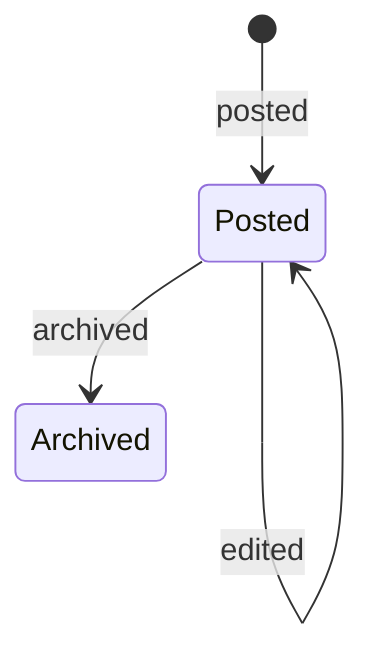

# Announcements

- **Status:** design (final demo, [0038](https://github.com/workforce-ops-app/.github/blob/main/docs/decisions/0038-final-demo-scope.md))
- **Related:** design workforce-ops-app/workforce-ops-backend#110; backend workforce-ops-app/workforce-ops-backend#120; screens workforce-ops-app/workforce-ops-frontend#65; tracker workforce-ops-app/.github#84; design: [authorization](../architecture/authorization.md), [organization](organization.md)

## In short
People who manage others post short announcements to the people they manage: a team, a department, or the whole company. Everyone sees the announcements meant for them, newest first, and marks them read; the people who posted can see who has read each one. The text is plain text with **bold** as the only formatting, and it is never treated as HTML, so an announcement cannot carry a script to the people who read it.

## Who can use it

| Role | Can | Permission | Scope |
|---|---|---|---|
| Everyone | read the announcements whose audience includes them; mark them read | none (signed in) | their own audiences |
| Manager | post, edit, and archive announcements for the department or team they manage; see who has read them | `announcement.create` | their assignment's scope |
| Owner, Administrator | the same, for any team or department, or the whole company | `announcement.create` | company |

These are the starting roles' defaults ([authorization](../architecture/authorization.md#starting-roles)): Employees do not get `announcement.create`; companies can change what their roles grant.

## How it works

```mermaid
sequenceDiagram
    participant M as Manager
    participant A as API
    participant E as Employee
    M->>A: POST /api/announcements {audience, title, body}
    A->>A: authorize: announcement.create covers the audience
    A->>A: save; audit announcement.posted
    E->>A: GET /api/announcements
    A-->>E: announcements whose audience includes them, newest first
    E->>A: POST /api/announcements/{id}/read
    M->>A: GET /api/announcements/{id}/reads
    A-->>M: who has read it, and who has not yet
```

1. A manager writes a title and a message and picks the **audience**: one team or one department they manage. Owners and administrators may also pick the whole company.
2. The announcement appears at once for everyone in the audience, on their home screen and the announcements page, newest first. Unread ones are marked.
3. Opening an announcement marks it read for that person.
4. The poster (and anyone else whose `announcement.create` covers the audience) sees how many people have read it, and who.
5. The text can be corrected later; the announcement then shows it was edited. When it is no longer needed, it is archived: it disappears for readers and stays for history.

---
## Details

### States and rules



**Audience**
- Exactly one of: the **company**, one **department**, or one **team** of the poster's company (an unknown one, or another company's: 422, like any unknown reference in a body).
- Posting needs `announcement.create` whose scope covers the audience, by the usual scope rules ([authorization](../architecture/authorization.md#scope-resolvers)): a company-wide assignment covers every audience; a department assignment covers that department and its teams; a team assignment covers that team. A company audience needs a company-wide assignment. Anything else: 403.
- The audience is fixed once posted, so an announcement never moves to people it was not written for. To reach other people, post a new one.
- **Who is in it** is worked out when someone reads, not when it is posted, so a person who joins the team later also sees it: for a team, its members; for a department, the people whose home department it is; for the company, everyone. Deactivated people are in no audience.
- An archived department or team takes no new announcements (409), and its announcements stop reaching anyone, as archived scopes cover nothing ([organization](organization.md#states-and-rules)).

**Text**
- A **title** of 1 to 120 characters and a **body** of 1 to 4,000 characters, surrounding spaces removed. Line breaks in the body are kept.
- The only formatting is **bold**, written as `**like this**`, as the report plan sets out for cross-site scripting. The API stores and returns the text exactly as typed; it never contains or accepts HTML. A pair of `**` marks is shown as bold; anything else, including a lone `**`, is shown as typed.
- The frontend builds the bold parts as `<strong>` elements whose content is set with `textContent`, and everything else as text nodes; it never uses `innerHTML` (threat T5). So `<script>` or `` in an announcement shows up as those characters, harmlessly.
- Text is a value only, never a template (threat I7).

**Editing and archiving**
- Anyone whose `announcement.create` covers the audience may edit the title and body, or archive the announcement, not only its author, so a manager's successor can tidy up. Each edit sets `edited_at`, and readers see "edited".
- Editing does not reset who has read it.
- Archived announcements cannot be edited (409) and are not shown to readers. They are never deleted ([0020](https://github.com/workforce-ops-app/.github/blob/main/docs/decisions/0020-status-over-deletion.md)).

**Read marks**
- `POST /announcements/{id}/read` records that the signed-in person has read it. Doing it again changes nothing (still 204). Only people in the audience can mark it (otherwise 404, as if it did not exist for them).
- The read list (`GET /announcements/{id}/reads`) shows the people in the audience now, each with when they read it, or not yet. Only people whose `announcement.create` covers the audience may see it.
- Reads are not audited: they are a record of the feature, not a security action, and every page view would otherwise grow the audit chain.

### Backend

**Endpoints** (all under `/api`, following [0026](https://github.com/workforce-ops-app/.github/blob/main/docs/decisions/0026-api-conventions.md)):

| Method and path | Permission | Does |
|---|---|---|
| `GET /announcements?cursor=&limit=` | signed in | page through the active announcements whose audience includes you, newest first, each with `read` (true or false) |
| `GET /announcements/managed?cursor=&limit=&include_archived=` | `announcement.create` (scope filter) | page through the announcements whose audience your assignments cover, with read counts |
| `GET /announcements/{id}` | in the audience, or `announcement.create` covering it | one announcement |
| `POST /announcements` `{audience_type, department_id?, team_id?, title, body}` | `announcement.create` covering the audience | post (201) |
| `PATCH /announcements/{id}` `{title?, body?}` | `announcement.create` covering the audience | correct the text |
| `POST /announcements/{id}/archive` | `announcement.create` covering the audience | archive |
| `POST /announcements/{id}/read` | in the audience | mark read (204) |
| `GET /announcements/{id}/reads` | `announcement.create` covering the audience | who in the audience has read it, and when |

An announcement in an answer: `id`, `audience` (`{type, department_id, team_id}` with names), `title`, `body`, `author` (`{id, display_name}`), `posted_at`, `edited_at`, `archived`, and for readers `read`, for managers `read_count` and `audience_count`.

**Table: `announcements`** (feature table)

| Column | Type | Rules |
|---|---|---|
| `id` | `BINARY(16)` | primary key |
| `company_id` | `BINARY(16)` | required |
| `author_id` | `BINARY(16)` | required; company-aware foreign key to `users` |
| `audience_type` | `VARCHAR(10)` | `company`, `department`, or `team` |
| `department_id` | `BINARY(16)` | required for `department`, null otherwise; company-aware foreign key to `departments` |
| `team_id` | `BINARY(16)` | required for `team`, null otherwise; company-aware foreign key to `teams` |
| `title` | `VARCHAR(120)` | required |
| `body` | `TEXT` | required; at most 4,000 characters, checked by the API |
| `edited_at` | `DATETIME(6)` | null until edited |
| `archived_at` | `DATETIME(6)` | null while active |

A `CHECK` keeps the audience columns consistent: exactly the ID its type needs, and no other. An index on (`company_id`, `created_at`) serves the newest-first lists.

**Table: `announcement_reads`** (feature table)

| Column | Type | Rules |
|---|---|---|
| `company_id` | `BINARY(16)` | required |
| `announcement_id` | `BINARY(16)` | part of the primary key; company-aware foreign key to `announcements` |
| `user_id` | `BINARY(16)` | part of the primary key; company-aware foreign key to `users` |
| `read_at` | `DATETIME(6)` | required |

| From | To | How many | Enforced by | Meaning |
|---|---|---|---|---|
| users | announcements | one to many | company-aware foreign key | A person can post many announcements |
| departments, teams | announcements | one to many | company-aware foreign keys | An announcement's audience is one department or one team (or the company) |
| announcements | announcement_reads | one to many | company-aware foreign key | Each read mark belongs to one announcement |
| users | announcement_reads | one to many | company-aware foreign key, primary key (one per person) | A person reads an announcement at most once |

**Scope resolver:** an announcement belongs to its audience: a department audience to that department; a team audience to the team and its department; a company audience to no department, so only a company-wide assignment covers it. It belongs to no employee, so no self permission applies to it.

**Audience filter:** the reader's list is limited in the database to the company, the reader's home department, and the teams they are on, with the same tenancy filter as every other query ([tenancy](../architecture/tenancy.md)); announcements for other audiences are never loaded.

### Demo data

The seed script adds, in each demo company, through the same service the application uses (audited as `announcement.posted` under the poster's name):
- a company-wide announcement from the owner;
- a Kitchen announcement from the Kitchen manager, and a Weekend Crew one from the crew lead;
- one archived announcement, and one edited;
- an announcement whose body includes `**bold**` and text that would run if shown unsafely (for example ``), so the demo shows both the bold and the plain-text display;
- read marks for some readers, so the read counts differ.

### Audit and security

**Audit events:** `announcement.posted` (details: audience type and ID), `announcement.edited` (details: which fields), `announcement.archived`. The text itself is not copied into the audit log.

**Threats** ([threat model](../security/threat-model.md)): E11 (posting to people outside your scope), T5 (stored XSS in the text), I9 (reading announcements meant for others, or who read what), I1 and T3 (other companies), T2 (setting the author or audience directly), I7 (text used as a template), D2 (oversized text).

**Security tests:**
- Every endpoint, requested as a user of the other demo company, answers 404; an audience naming another company's department or team answers 422.
- A team manager cannot post to their department or the company, and a department manager cannot post to another department or the company (403); employees cannot post at all.
- A person outside an announcement's audience does not see it in their list, gets 404 for it and for marking it read, and cannot see its read list.
- Text with `<script>`, ``, and `{0.__class__}` is stored and returned exactly as typed (the frontend test checks it is shown as text).
- The author, audience, and dates cannot be set or changed through the request body (422).
- An archived department's announcements reach nobody.

### Slices

Filed under tracker workforce-ops-app/.github#84 once this design merges: the backend slices as sub-issues of #120, the screens under workforce-ops-app/workforce-ops-frontend#65. Each is one pull request.

| ID | Repository | Slice | Depends on |
|---|---|---|---|
| AN1 | backend | `announcements` and `announcement_reads` tables (one migration), `announcement.create` with the starting roles, the scope resolver, posting, editing, archiving, and the managed list | this design |
| AN2 | backend | reading: the audience filter, one announcement, read marks, and the read list | AN1 |
| AN3 | backend | announcements in the demo data | AN2 |
| AN4 | frontend | reading announcements on the home screen and the announcements page, with the bold display built safely | AN2 |
| AN5 | frontend | posting, editing, and archiving, and the read list | AN1, AN4 |

### Known limitations
- No notifications: people see new announcements when they open the application (notifications are stretch, 0038).
- No attachments, images, or links that open automatically; links are shown as text.
- No scheduling an announcement for later, and no expiry: it stays until archived.
- An audience is one team, one department, or the company; several at once means several announcements.
