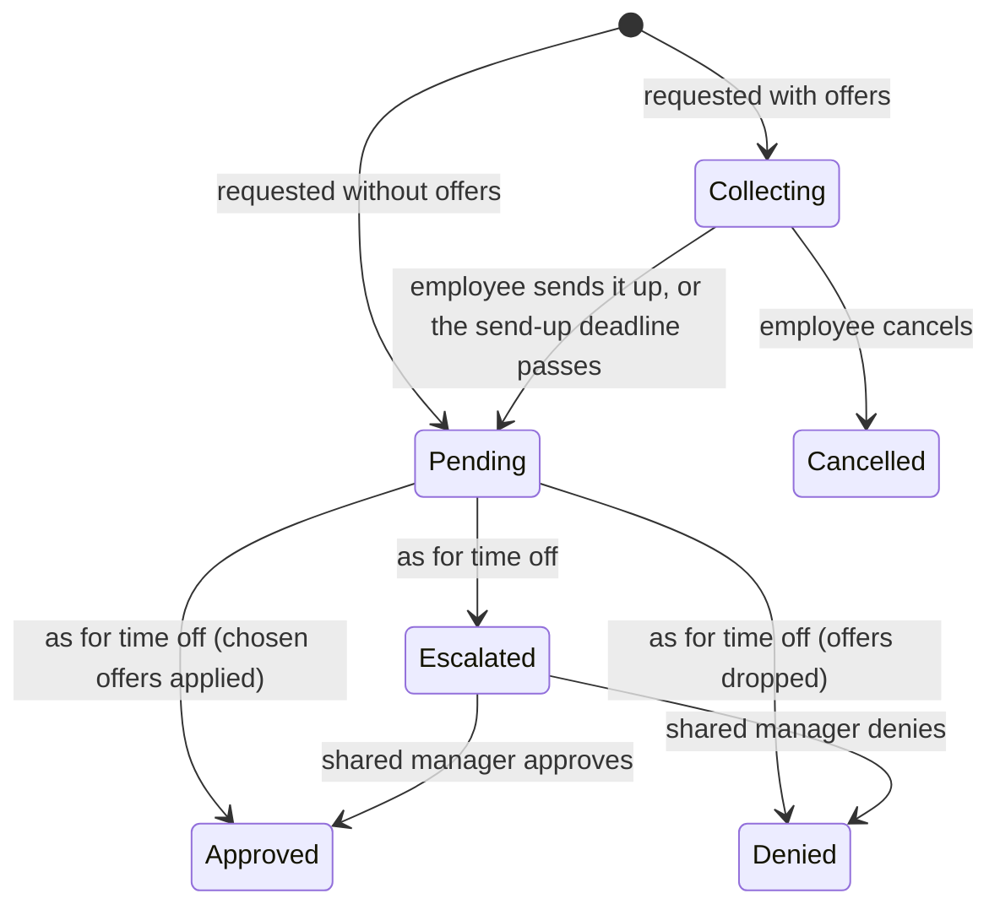

# Shift swaps and coverage

- **Status:** design, rewritten 2026-11-20 after review: coverage now starts from a time-off request (agreed by both teammates; replaces the shift-by-shift design of #153) (final demo, [0038](https://github.com/workforce-ops-app/.github/blob/main/docs/decisions/0038-final-demo-scope.md))
- **Related:** design workforce-ops-app/workforce-ops-backend#111; backend workforce-ops-app/workforce-ops-backend#121; screens workforce-ops-app/workforce-ops-frontend#66; tracker workforce-ops-app/.github#85; routing [0029](https://github.com/workforce-ops-app/.github/blob/main/docs/decisions/0029-request-approval-routing.md); design: [time off](time-off.md), [schedules](schedules.md), [authorization](../architecture/authorization.md)

## In short

An employee asking for time off can tick **Offer Shift Swap / Coverage**. Their coworkers in the department then see the request and, for each of the employee's shifts on those days, may **offer to cover** it, **offer to swap** it for one of their own shifts, **decline**, or just ignore it. The employee sends the request to their managers whenever they like; if they have not by a deadline (by default midnight at the start of the day before the time off starts), it goes up by itself as it is. The manager sees the time off with every offer and, for each shift, chooses **none or one** offer and approves, or declines the whole request. Nothing on the schedule changes until the time off is approved, and every chosen offer is checked again at that moment.

Without the tick, a time-off request works exactly as before ([time off](time-off.md)).

## Who can use it

| Who | Can | Permissions | Scope |
|---|---|---|---|
| Employee asking for time off | tick the box; see every offer on their own request; send it up early; cancel it | `time_off.request_self`, `time_off.cancel_self` | own requests |
| Coworker | see the requests they could help with; offer to cover, offer to swap, or decline, per shift; change or take back their own answer until the request goes up | `coverage.respond_self` | only requests with a shift they could be assigned |
| Reviewer (the time-off reviewers) | see the time off with every offer; choose none or one offer per shift and approve, or decline | `time_off.review` (above the employee), and `schedule.edit` covering every shift a chosen offer changes | as for time off |
| Manager of the department | raise the department's send-up minimum (more days before, never fewer than the company's); with several managers, all must confirm | `time_off.review` through a grant for that department, or company-wide (see "The send-up minimum") | their department |

## How it works

```mermaid
sequenceDiagram
    participant E as Employee
    participant A as API
    participant C as Coworkers
    participant M as Manager
    E->>A: POST /api/time-off-requests {days, offer_coverage: true}
    A-->>C: listed on their home screen (no notifications in the final)
    C->>A: per shift: cover / swap (with one of their shifts) / decline
    alt the employee sends it up, or the send-up deadline passes
        A-->>M: waiting for review, with every offer
    end
    M->>A: approve {choices: one offer or none per shift}, or deny
    A-->>E: approved: chosen offers applied, other shifts open; or declined
```

1. **Asking.** On My time off, the employee picks the days and may tick **Offer Shift Swap / Coverage**. The request starts as **collecting offers** (status `collecting`) instead of waiting for review. Not ticked: it waits for review at once, as today.
2. **Offering.** Every coworker who could take at least one of the employee's shifts on those days sees the request on their home screen and its own page. For each such shift they answer **cover** (they take it), **swap** (they take it and give the employee one of their own shifts in exchange), or **decline**; or they ignore it. They may change or take back their answer while the request is collecting.
3. **Sending up.** The employee may send the request up at any time (**Send to my manager**). If they have not by the **send-up deadline**, it goes up by itself, as it is, the first time anyone reads or acts on it after the deadline (no background job, as for lapsing). From then on it is **waiting for review**, the offers are locked, and it follows the time-off rules (reviewers, escalation, declined if not reviewed).
4. **Deciding.** The reviewer sees the time off, the affected shifts, and every offer per shift. They choose **none or one** offer for each shift and approve, or decline the whole request.
   - Approved with an offer chosen for a shift: **cover**: the coworker takes the shift; **swap**: the coworker takes the shift and the employee takes the coworker's offered shift.
   - Approved with no offer for a shift: the shift becomes **open**, as for any approved time off.
   - Declined: nothing changes; every offer is dropped.
5. **Cancelled** (by the employee, at any time before a decision, or an approved one before its first day): every offer is dropped; the schedule changes only as for time off.

## Details

### States and rules



**Asking with offers**
- Only possible while the send-up deadline is still ahead (409 "It is too late to ask coworkers for these days; send the request without offers."). The deadline is the start of the day that is *minimum* days before the first day, in the employee's workplace zone: **midnight at the beginning of that day, not the end of it**. With the default minimum of 1, time off starting on a Friday stops collecting offers at 00:00 on Thursday, so the last moment to offer is late on Wednesday.
- A request with no shifts on its days can still be asked with the box ticked; nobody can offer anything, and it goes up as usual.
- The deadline is noticed the next time anyone reads or acts on the request (no background job, as for lapsing in [time off](time-off.md#backend)); the request then goes up as the system, with `sent_up_at` set to the deadline. If nobody looks before the first day begins, it is declined as not reviewed, as any request is.

**Who can offer, per shift** (checked when they offer and again at approval; 409 with the reason otherwise)
- Not the employee themselves.
- Someone who could be assigned that shift: active, set up, and the shift's department is their home department or they are on an active team in it (the same rule as assigning, [schedules](schedules.md#states-and-rules)).
- For **cover**: no overlapping shift of their own and no approved time off at that time.
- For **swap**: the shift they give must be their own, scheduled, not started, **in the same department**, and **outside the employee's time off**; the employee must be able to work it (no overlap with the employee's other shifts, no approved time off then); and after the exchange neither person has two overlapping shifts (the two traded shifts are left out of that check). A coworker may offer a swap even when the requested shift overlaps the very shift they give.
- One answer per coworker per shift; a new answer replaces the old one. "Ignore" means no answer.

**Who sees what** (threat I10)
- A coworker sees only what they need to decide whether they can cover or swap: the employee, the days, the affected shifts, and **only their own answers**, never the others'. **Never the reason** for the time off (it may be medical or otherwise personal; review of #188): the field is left out of every coworker answer (the offerable list and `GET /{id}` seen as a coworker), not sent empty for the screen to hide.
- The employee and the managers see the reason and **every offer**, by name: anyone whose `time_off.view` covers the employee, and the request's reviewer (while collecting a request has no reviewer yet, so "the reviewers" means the people who will review it).
- A coworker may see a request they could work a shift of while it is collecting, and afterwards any request they answered. They never see the reviewers' decisions or who is still to decide.
- On the offer endpoints, someone who could not work any of its shifts (and never answered) gets 404. On `GET /{id}`, anyone else in the company gets 403, as for any time-off request; everyone in another company gets 404. (Built in CV1: the design first said 404 for all of them; 403 keeps `GET /{id}` the same as for every other request.)

**The send-up minimum**
- The number of days before the first day at which a collecting request goes up by itself.
- **Software default 1** (the day before the time off starts).
- A **company setting**, `time_off.offers_close_days`, may raise it (1 to 14; more is stricter: reviewers get longer), declared with the time-off settings.
- A **department** may raise it further, never below the company's: `department_settings` holds one row per department and setting. The value used is the larger of the company's and the department's.
- **The department's managers** are the active people holding `time_off.review` through an assignment for that department (not company-wide ones). One of them, or someone holding it company-wide (an owner or administrator), may change the department's value.
- With **several managers**, the change is an approval request of kind `department_setting` that **every other one of the department's managers** must approve before it takes effect (one denial stops it; 7-day deadline, as role grants). With one manager (or none besides the person changing it), it takes effect at once. Audited as `settings.department_changed`.
- The deadline of a request is fixed when it is asked (stored as `offers_close_at`), so a later change does not move it.

**Deciding**
- Who reviews, how decisions add up, escalation, and lapsing are exactly as for time off. **The reviewer whose approval settles the request chooses the offers** (the choices sent with that approval apply); the others only approve or decline the time off.
- Choices are `{shift_id: offer_id}` for any of the request's shifts; a shift left out gets none. Sent as a list, `choices: [{shift_id, offer_id}]`, at most one per shift. A choice that is not a cover or swap offer made on this request for that shift (another request's, a declined answer, an unknown or another company's ID) is 422; an offer no longer open is 409. Every approval's choices are kept with the approval record (`payload.choices`, by reviewer), but only the settling one's are applied (built in CV2).
- Choosing an offer needs `schedule.edit` covering every shift it changes (the requested shift and, for a swap, the offered one); otherwise 403 and nothing changes. Approving without choices needs only what time off needs.
- **The re-check at approval** runs in the same transaction, after the time-off locks (lines, the employee, the request, its approval) and then the coworkers' rows and every shift involved, in ID order (the order of every schedule change): each chosen offer must still pass every rule above. If one fails, nothing changes, the answer is 409 naming the shift and the reason, and the reviewer can choose another offer or none.
- Applying: chosen covers and swaps reassign their shifts (`shift.assigned`, details: the request and the offer); every other shift of the employee on those days becomes open (`shift.opened`), as today.

**Endings**
- Declined, cancelled, or declined as not reviewed: the offers stay as a record but are marked `dropped`; approved: `chosen` or `not_chosen`.
- A coworker's offered shift that changes meanwhile simply fails the re-check if chosen.

### Backend

**Table: `time_off_requests`** gains:

| Column | Type | Notes |
|---|---|---|
| `offers_close_at` | `DATETIME(6)` | null: asked without offers. When a collecting request goes up by itself |
| `sent_up_at` | `DATETIME(6)` | null while collecting (or asked without offers): when it went up, by the employee or by the deadline |

and the status `collecting` (the `CHECK` lists it). The approval record is opened when the request is asked, as today; while the request is `collecting`, its reviewers are nobody (the time-off handler returns an empty set), so no one can decide it and it is on nobody's waiting list.

**Table: `coverage_offers`** (company-owned)

| Column | Type | Notes |
|---|---|---|
| `id`, `company_id`, `created_at`, `updated_at` | | conventions |
| `time_off_request_id` | `BINARY(16)` | the request (same company, composite FK) |
| `shift_id` | `BINARY(16)` | the employee's shift the answer is about |
| `offered_by` | `BINARY(16)` | the coworker |
| `answer` | `VARCHAR(8)` | `cover`, `swap`, or `decline` |
| `swap_shift_id` | `BINARY(16)` | for `swap` only: the coworker's shift given in exchange (`CHECK`) |
| `status` | `VARCHAR(10)` | `offered`, `chosen`, `not_chosen`, `dropped` |

Unique `(company_id, time_off_request_id, shift_id, offered_by)`: one answer per coworker per shift.

**Table: `department_settings`** (company-owned, migration `0016`): `department_id` (company-aware foreign key to `departments`), `module` and `setting_key` (as in `company_settings`), `value` (JSON), `created_at`, `updated_at`; primary key `(company_id, department_id, module, setting_key)`. Only for settings a module declares with `per_department=True` (`time_off.offers_close_days` for now), and only stricter than the company's when written; read as the stricter of the two anyway, so a company that later raises its own value is never undercut. (Built in CV3: the design first named one `key` column; `module` and `setting_key` match `company_settings`.)

**Endpoints** (all under `/api`)

| Method and path | Who | What |
|---|---|---|
| `POST /time-off-requests` `{first_day, last_day, reason?, offer_coverage?}` | `time_off.request_self` | ask; `offer_coverage: true` starts it collecting (409 if too late) |
| `POST /time-off-requests/{id}/send-up` | the employee | collecting → waiting for review |
| `GET /time-off-requests/offerable` | `coverage.respond_self` | the collecting requests (not your own) with a shift you could take, each with those shifts and your answers |
| `PUT /time-off-requests/{id}/offers/{shift_id}` `{answer, swap_shift_id?}` | `coverage.respond_self` | answer for one shift (replaces your earlier answer) |
| `DELETE /time-off-requests/{id}/offers/{shift_id}` | the coworker (`coverage.respond_self`) | take back your answer while collecting (204); the row is removed, and `coverage.withdrawn` keeps the record |
| `GET /time-off-requests/{id}` | as today | also `offers`: every offer for the employee and the reviewers; only your own for a coworker |
| `POST /time-off-requests/{id}/approve` `{comment?, choices?: [{shift_id, offer_id}]}` | as today | approve; the choices apply if this approval settles it |
| `GET /departments/{id}/settings`, `PUT /departments/{id}/settings/offers_close_days` `{value}` | a manager of the department, or `time_off.review` company-wide | read (each setting with `company_value`, `department_value`, `value` in force, `limit`, and any `pending` change with who it waits for); change: 200 `{value}` at once, or 202 `{approval_request_id}` when other managers must confirm; 409 while another change waits; 422 below the company's value or past the limit. The other managers confirm or refuse through `/api/approval-requests/{id}/approve` and `/deny` |

**Permissions:** `coverage.respond_self` (self), given to every starting role; existing companies get it on their starting roles in the migration. `coverage.request_self` and `coverage.review` from the first design are not used: asking is part of time off, and reviewing is `time_off.review`.

**Code:** `app/modules/time_off/` keeps the request and gains `offers.py` (who may offer, the answers, the lists) and the choices in `review.py`'s `approve`; the per-department values are read and written in `app/settings/` (`department_value`, `change_department_setting`), and the endpoints, the department's managers, and the `department_setting` approval kind live in `app/modules/department_settings/` (built in CV3; the design first put the kind next to the time-off handler, but a module of its own gets its own router).

### Demo data

In each company, two Kitchen requests asked with offers, through the services as the people involved:
- one still **collecting**: one coworker offered to cover a shift, another offered a swap with one of their own shifts, and a third declined, so the demo shows the offers, sending it up, and choosing one;
- one already **sent up**, with one cover offer, waiting for its reviewer.
Someone from another department gets no card (not eligible).

### Audit and security

**Audit events:** `time_off.requested` (details: `offer_coverage`), `coverage.offered` (details: shift, answer, any swap shift; a changed answer writes another), `coverage.withdrawn`, `time_off.sent_up` (details: `by` is `employee` or `deadline`; the deadline one has actor `system` and happens at the deadline itself), `time_off.approved` (details: the chosen offers), `shift.assigned` per reassigned shift (details: request and offer), `shift.opened` as today, `settings.department_changed`, and the approval events for `department_setting`.

**Threats** ([threat model](../security/threat-model.md)): E12 (moving shifts without approval, or a reviewer choosing their own offer), T8 (offering a shift you could not take, or one that is not yours), I10 (seeing other coworkers' answers), E5 (approving your own request), E3 (reviewing someone you are not above), I1 and T3 (other companies), T2 (setting status or choices directly), T5 (reasons and comments).

**Security tests:**
- Every new endpoint, as a user of the other demo company: 404; naming another company's shift: 422.
- A coworker who could not be assigned the shift, has an overlapping shift, or is on time off then cannot offer to cover (409); a swap with someone else's shift, a shift in another department, one inside the employee's time off, or one the employee could not work, is refused.
- The employee cannot offer on their own request; nobody can offer after it went up (409).
- A coworker sees only their own answers; a person who could not take any of its shifts gets 404.
- Nothing on the schedule changes before approval; choices sent with a non-settling approval do not apply; choosing without `schedule.edit` over the changed shifts is 403 and changes nothing.
- A reviewer cannot choose their own offer (a reviewer who offered is refused that choice, E12).
- The re-check refuses a chosen offer whose coworker was deactivated, got an overlapping shift or time off, or whose swap shift was reassigned, and nothing changes.
- A collecting request is on nobody's waiting list and cannot be decided (403); after its deadline the first read sends it up.
- A department minimum below the company's is refused (422); someone who is not one of the department's managers (nor company-wide) gets 403; with two managers, one alone cannot change it; one denial stops it.

### Slices

| ID | Repository | Slice | Depends on |
|---|---|---|---|
| CV1 | backend | asking with offers, the collecting state and sending up (by the employee and at the deadline), `coverage_offers` with offering, changing, and withdrawing, the lists, `coverage.respond_self` with the starting roles, the company setting (one migration) | this design |
| CV2 | backend | choosing offers at approval: the choices, the re-check, applying covers and swaps, the offer endings | CV1 |
| CV3 | backend | the department minimum: `department_settings`, the endpoints, the `department_setting` approval kind (one migration) | CV1 |
| CV4 | backend | demo data | CV2 |
| CV5 | frontend | the checkbox and "Send to my manager" on My time off, the offers list there; the coworkers' card on the home screen and the offer form | CV1 |
| CV6 | frontend | the reviewer's card: offers per shift, choose none or one, approve or decline | CV2, CV5 |
| CV7 | frontend | the department minimum on the structure screen (with the waiting confirmation) | CV3 |

### Known limitations
- No notifications: coworkers see requests on their home screen (stretch, 0038).
- Coverage starts only from a time-off request; asking coworkers to take a single shift without time off is stretch.
- A swap trades exactly two shifts between two people.
- No weekly hour or rest-time limits (stretch, workforce-ops-app/workforce-ops-backend#99).
- A request sent up has its offers locked; a coworker who changes their mind afterwards tells the manager in person.
