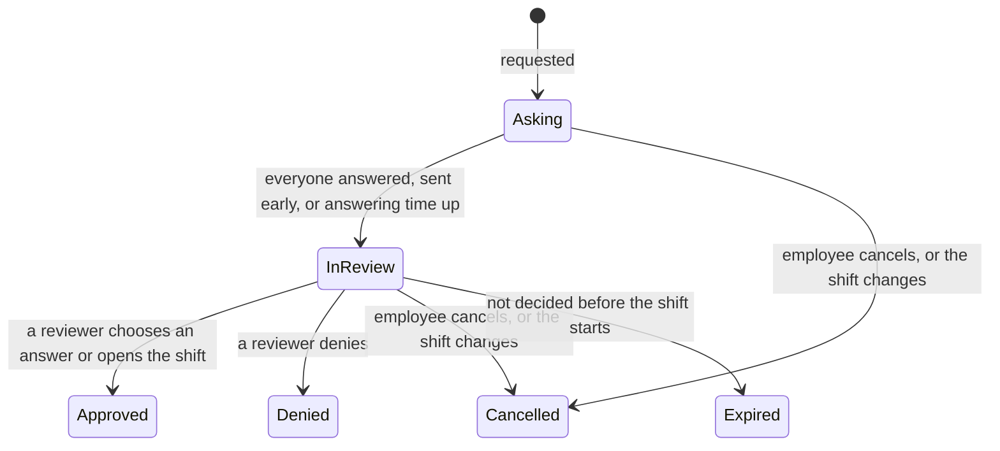

# Shift swaps and coverage

- **Status:** design (final demo, [0038](https://github.com/workforce-ops-app/.github/blob/main/docs/decisions/0038-final-demo-scope.md))
- **Related:** design workforce-ops-app/workforce-ops-backend#111; backend workforce-ops-app/workforce-ops-backend#121; screens workforce-ops-app/workforce-ops-frontend#66; tracker workforce-ops-app/.github#85; routing [0029](https://github.com/workforce-ops-app/.github/blob/main/docs/decisions/0029-request-approval-routing.md); design: [schedules](schedules.md), [time off](time-off.md), [authorization](../architecture/authorization.md)

## In short
An employee who cannot work one of their shifts asks their coworkers for help. Each coworker asked answers **accept** (they take the shift), **swap** (they take it and give one of their own shifts in exchange), or **decline**. When everyone has answered, or the answering time is up, the list of answers goes to the employee's managers, who choose one answer, open the shift for someone else, or say no. Nothing on the schedule changes until a manager approves, and everything is checked again at that moment.

## Who can use it

| Role | Can | Permission | Scope |
|---|---|---|---|
| Everyone | ask for coverage of their own shift; cancel their request; answer requests they are asked about | `coverage.request_self`, `coverage.respond_self` | own shifts and own answers |
| Manager | choose an answer, open the shift, or deny, for the requests of people they are above | `coverage.review` (and `schedule.edit` for every shift that changes) | their scope; also needs a position above the employee |
| Owner, Administrator | the same, company-wide | `coverage.review`, `schedule.edit` | company; still needs a position above (the Owner is above everyone) |

These are the starting roles' defaults ([authorization](../architecture/authorization.md#starting-roles)); companies can change what their roles grant.

## How it works

```mermaid
sequenceDiagram
    participant E as Employee
    participant A as API
    participant C as Coworkers asked
    participant M as Managers (reviewers)
    E->>A: POST /api/coverage-requests {shift, coworkers to ask}
    A->>A: checks: own upcoming shift, coworkers can work it
    C->>A: answer: accept / swap (with one of their shifts) / decline
    alt everyone answered, the employee sends it early, or answering time is up
        A-->>M: the request and its answers wait for review
    end
    M->>A: approve {coworker} or {open the shift}, or deny
    A->>A: check everything again; change the shifts; audit
    A-->>E: outcome shown on their page
```

1. On one of their upcoming shifts, the employee chooses **Ask for coverage**, adds an optional note ("family wedding"), and picks the coworkers to ask. The screen lists everyone who could work that shift, all ticked by default.
2. Each coworker asked sees the request on their home screen and answers **accept**, **swap** (picking one of their own upcoming shifts to give in exchange), or **decline**. They may change their answer while answering is open.
3. Answering ends when **everyone asked has answered**, when the employee **sends it early**, or **12 hours before the shift** (a company setting), whichever comes first. The request then waits on the reviewers' page, with every answer.
4. A reviewer (one of the employee's direct managers, found through the reporting chain as for time off) does one of three things:
   - **chooses an answer:** the coworker takes the shift, and for a swap the employee takes the coworker's offered shift;
   - **opens the shift:** the employee no longer works it and it becomes an open shift for the manager to fill (useful when nobody could help);
   - **denies:** nothing changes, and the employee still works the shift.
5. Everyone involved sees the outcome on their pages. A request nobody decides before the shift starts **expires**, and the employee still works the shift.

There are no notifications in the final demo (stretch, 0038): people see requests waiting for them on their home screen and the coverage page.

---
## Details

### States and rules



The table stores one status, `open`, while a request is asking or in review; which of the two it is follows from the times (see `review_opens_at` under Backend), so no job has to move it along and the outcome never depends on when a job last ran.

**Asking**
- Only for **your own scheduled shift** (status `scheduled`, you are its person) that has not started. Not for open, cancelled, or ended shifts (409).
- **Notice:** a request can be made only until answering would close, that is, earlier than `coverage.answers_close_hours` before the shift starts (409 after). So the reviewers always have at least that long to decide.
- **One open request per shift** (409 for a second one).
- **Limits per person** (threat D7): at most **10** open requests at a time, and at most **20** new requests in any 24 hours, cancelled ones included, so cancelling and asking again does not get around the first limit (409 for either). Both counts are taken with the employee's `users` row locked (`SELECT ... FOR UPDATE`, the same first lock as every schedule change), so two requests sent at the same moment cannot both slip under a limit.
- **The note** is optional, at most 500 characters, plain text (threat T5).
- **Who can be asked:** the people who could be assigned the shift under the schedule rules ([schedules](schedules.md#states-and-rules)): active, password set, home department is the shift's department or on an active team in it; never the employee themselves. The employee picks from them; leaving the list out asks all of them. At least 1 and at most 100 people; anyone else in the list is refused (422, with the same answer for a person who does not exist and one who cannot work the shift, so the list reveals nothing about other departments).
- Being asked does not depend on being free at that time: someone with an overlapping shift can still offer a **swap** with that very shift.
- Nobody can be asked about a request in another company: every lookup goes through the company filter (404).

**Answering**
- Only the people asked may answer, only while answering is open (409 after), and each may change their answer until then. The answers:
  - **accept:** the coworker would take the shift. Refused (409) if they already have a shift that overlaps it, or approved time off on that day (once time off exists).
  - **swap:** the coworker names **one** of their own scheduled, upcoming shifts. It must not start before answering closes (the same notice as asking), the employee must be someone who could be assigned it, and after the exchange neither person may have two overlapping shifts (the two traded shifts are left out of that check). Otherwise 422 or 409.
  - **decline.**
- An answer is a promise to be checked, not a change: the schedule does not move until a reviewer approves.
- **When the last person asked answers**, answering ends at once and the request goes to review.
- The employee may **send it early** (`POST .../send`) with whatever answers have come in.

**Reviewing**
- **Who reviews:** the employee's direct managers who hold `coverage.review`; when none can (or the employee has no manager), the request moves up the reporting chain one level at a time, ending at the Owner, exactly as for time off. Anyone higher in the chain may also step in ([0029](https://github.com/workforce-ops-app/.github/blob/main/docs/decisions/0029-request-approval-routing.md)). Reviewers are checked again at the moment they decide.
- **One decision settles it.** A reviewer chooses one answer, so two approvals could pick different coworkers; the required number of approvals is therefore fixed at **1** for coverage and there is no disagreement step. The first decision settles the request; a second reviewer then gets 409. (0029's company setting for required approvals stays with time off; a coverage version is stretch.)
- **What a reviewer needs:** `coverage.review` over the employee (a person permission: scope covers them, and the reviewer is above them), **and** `schedule.edit` covering every shift the decision changes: the requested shift, and for a swap the offered shift too. A reviewer who lacks either gets 403; someone higher up can decide instead.
- **No self-dealing:** nobody reviews their own request, and nobody approves an answer they gave themselves (a manager who was asked as a coworker cannot choose their own answer; another reviewer can).
- **Decisions are only possible in review**, never while asking, and never once the shift has started (409).
- **The re-check at approval** ([0029](https://github.com/workforce-ops-app/.github/blob/main/docs/decisions/0029-request-approval-routing.md)): in one transaction, with the people's rows and then the shifts locked in the same order as every schedule change ([schedules](schedules.md#states-and-rules)), the API checks again that the requested shift is still the employee's and has not started; for the chosen answer, that the coworker is still active and could still be assigned it, and is not double-booked or on time off; for a swap, that the offered shift is still the coworker's, scheduled, not started, and that the employee can still work it without overlaps. If anything fails, nothing changes and the answer is 409, with which part no longer holds, so the reviewer can choose another answer.
- **On approval**, `approve()` takes these steps in this order, all in the one transaction of the re-check:
  1. lock the rows and run the re-check (above);
  2. mark this request `approved` and record the decision on its approval record. This clears `open_shift_id`, so the request is no longer open when its own shift changes in the next step, and the schedules hook that ends a changed shift's open request (below) leaves it alone;
  3. change the shifts, through the schedules service's usual steps:
     - an **accept**: the shift is assigned to the coworker;
     - a **swap**: the shift is assigned to the coworker, and the offered shift to the employee. If the coworker had an open request of their own for the offered shift, the hook ends that one (`cancelled`, reason `shift_changed`), as for any shift change;
     - **open the shift**: the shift becomes open (person cleared), as when a manager removes someone ([schedules](schedules.md));
  4. write the audit entries: `coverage.approved`, each shift change's usual `shift.assigned` or `shift.opened` entry (with this request's ID in its details), and `coverage.cancelled` for any other request the swap ended.

  If any step fails, the whole transaction is rolled back: no request, approval record, shift, or audit entry changes.
- **Denying** takes an optional comment (at most 500 characters, plain text) and changes no shift.

**Ending without a decision**
- **Cancelled by the employee:** any time before a decision (`POST .../cancel`).
- **Cancelled because the shift changed:** when a manager reassigns, opens, cancels, or changes the times of a shift with an open request, the schedules service ends that request (status `cancelled`, reason `shift_changed`) in the same transaction, so a request never outlives the shift it was about. Answers that offered a shift which has since changed are not ended; they simply fail the re-check if chosen.
- **Expired:** a request still open when its shift starts is ended as `expired` (actor `system`). At least once an hour a background job records this; the API refuses decisions after the start either way.
- Each of these also ends the request's shared approval record, in the same transaction (see **Approval record** under Backend).

**Not checked here**
- Weekly hour limits and rest time between shifts are stretch (workforce-ops-app/workforce-ops-backend#99, 0038); coverage checks only what every schedule change checks.

**Company setting**

| Setting | Declared in | Default | Companies may choose | Used by |
|---|---|---|---|---|
| `coverage.answers_close_hours` | `app/modules/coverage/settings.py` | 12 | 12 to 72 (more is stricter: reviewers get longer) | when answering closes, and how late a request can be made |

### Backend

**Endpoints** (under `/api`, [0026](https://github.com/workforce-ops-app/.github/blob/main/docs/decisions/0026-api-conventions.md)):

| Method and path | Permission | Does |
|---|---|---|
| `GET /coverage-requests/eligible?shift_id=` | `coverage.request_self`, own shift | the coworkers who can be asked about this shift (for the form) |
| `POST /coverage-requests` `{shift_id, note?, ask?: [user_id]}` | `coverage.request_self`, own shift | ask (201); leaving `ask` out asks everyone eligible |
| `GET /coverage-requests?mine=true&cursor=&limit=` | `coverage.request_self` | your own requests, newest first, each with every answer |
| `GET /coverage-requests/asked?cursor=&limit=` | `coverage.respond_self` | requests you were asked about, unanswered first, each with your own answer only |
| `GET /coverage-requests/waiting?cursor=&limit=` | signed in | requests in review that you may decide, soonest shift first |
| `GET /coverage-requests/{id}` | the employee, someone asked, or a reviewer | one request; what it includes depends on who asks (below) |
| `POST /coverage-requests/{id}/answer` `{answer, offered_shift_id?}` | `coverage.respond_self`, asked | answer or change your answer (`accept`, `swap`, `decline`) |
| `POST /coverage-requests/{id}/send` | the employee | end answering early and send it to review |
| `POST /coverage-requests/{id}/cancel` | `coverage.request_self`, the employee | cancel |
| `POST /coverage-requests/{id}/approve` `{coworker_id}` or `{open_shift: true}` | `coverage.review` over the employee, `schedule.edit` on every shift that changes | approve (exactly one of the two fields) |
| `POST /coverage-requests/{id}/deny` `{comment?}` | `coverage.review` over the employee | deny |

**What each person sees** (threat I10): the **employee** sees their request with every person asked and their answer; a **coworker asked** sees the request (the shift, the employee, the note) and only their own answer, never the others'; a **reviewer** sees everything, including each offered shift. Anyone else gets 404, as if the request did not exist, and so does everyone in another company.

A request in an answer: `id`, `shift` (as in the shift list), `requester` (`{id, display_name}`), `note`, `stage` (`asking`, `in_review`, or the final status: `approved`, `denied`, `cancelled`, `expired`), `answers_close_at`, `review_opens_at`, `answers` (`[{coworker: {id, display_name}, answer, offered_shift, answered_at}]`, filtered as above), and once decided `outcome` (`covered`, `swapped`, `opened`, or null), `decided_by`, `decided_at`, `comment`.

**Errors:** 401 not signed in, 403 not allowed, 404 not found (another company's, or not yours to see), 409 not possible in the current state (answering closed, already decided, shift started, double booking, the re-check failed, too many open requests), 422 invalid input (an unknown or ineligible person to ask, a swap shift that cannot be traded, both or neither of `coworker_id` and `open_shift`, any field the request may not set).

**Table: `coverage_requests`** (feature table)

| Column | Type | Rules |
|---|---|---|
| `id` | `BINARY(16)` | primary key |
| `company_id` | `BINARY(16)` | required |
| `shift_id` | `BINARY(16)` | required; company-aware foreign key to `shifts` |
| `requester_id` | `BINARY(16)` | required; company-aware foreign key to `users`; the shift's person when asked |
| `note` | `VARCHAR(500)` | optional; plain text |
| `status` | `VARCHAR(12)` | `open`, `approved`, `denied`, `cancelled`, or `expired` |
| `open_shift_id` | `BINARY(16)` | the shift's ID while `open`, null otherwise; **unique**, so the database itself refuses a second open request for one shift (a unique index allows any number of nulls) |
| `created_at` | `DATETIME(6)` | required; when it was asked (counts toward the 20-in-24-hours limit) |
| `answers_close_at` | `DATETIME(6)` | required; the shift's start minus `coverage.answers_close_hours`, fixed when asked |
| `review_opens_at` | `DATETIME(6)` | required; starts equal to `answers_close_at`, and moves to the moment the last answer comes in or the employee sends it early. The request is in review when it is `open` and this moment has passed |
| `approval_request_id` | `BINARY(16)` | company-aware foreign key to `approval_requests` (kind `coverage`, `required_approvals` 1, `review_by` the shift's start); unique; added by CV2 and required from then on (below) |
| `outcome` | `VARCHAR(8)` | `covered`, `swapped`, or `opened` once approved; null otherwise |
| `chosen_coworker_id` | `BINARY(16)` | the coworker whose answer was chosen; null unless `covered` or `swapped` |
| `end_reason` | `VARCHAR(16)` | for `cancelled`: `requester` or `shift_changed` |
| `decided_by` | `BINARY(16)` | the reviewer; null for cancelled and expired requests |
| `decided_at` | `DATETIME(6)` | null while open |
| `comment` | `VARCHAR(500)` | optional, a reviewer's comment on a denial; plain text |

`CHECK` constraints keep it consistent: `open_shift_id` equals `shift_id` exactly when `status = 'open'`; `outcome` is set exactly when `approved`; `chosen_coworker_id` is set exactly for `covered` and `swapped`. Indexes on (`company_id`, `requester_id`, `created_at`) and (`company_id`, `review_opens_at`) serve the lists and the limits.

**Table: `coverage_answers`** (feature table): one row per person asked.

| Column | Type | Rules |
|---|---|---|
| `company_id` | `BINARY(16)` | required |
| `request_id` | `BINARY(16)` | part of the primary key; company-aware foreign key to `coverage_requests` |
| `coworker_id` | `BINARY(16)` | part of the primary key; company-aware foreign key to `users` |
| `answer` | `VARCHAR(8)` | `pending` (not answered yet), `accept`, `swap`, or `decline` |
| `offered_shift_id` | `BINARY(16)` | required for `swap`, null otherwise (`CHECK`); company-aware foreign key to `shifts` |
| `answered_at` | `DATETIME(6)` | null while `pending` |

| From | To | How many | Enforced by | Meaning |
|---|---|---|---|---|
| shifts | coverage_requests | one to many, at most one open | company-aware foreign key; unique `open_shift_id` | A shift can be asked about again after a request ends, but only one request is open at a time |
| users | coverage_requests | one to many | company-aware foreign key | A person can ask about many of their shifts |
| coverage_requests | coverage_answers | one to many | company-aware foreign key | The people asked, and their answers |
| users | coverage_answers | one to many | company-aware foreign key, primary key (one per request) | A person answers a request at most once (and may change it) |
| shifts | coverage_answers | one to many | company-aware foreign key | A shift offered in exchange |
| coverage_requests | approval_requests | one to one | company-aware foreign key, unique | The shared approval record holding the decision |

**Approval record:** kind `coverage`; `subject_user_id` the employee; `required_approvals` 1; `review_by` the shift's start; the payload names the request. It is created with the request, in the same transaction, so it is `pending` while the request is asking and while it is in review (the reviewers' list still shows only requests whose `review_opens_at` has passed). The single decision is stored in `approval_decisions` like any other, which keeps the shared "pending approvals" record of 0029: the reviewer routing, the reviewers' page, and the audit of decisions work the same way for time off and coverage.

Every change of a coverage request's status changes its approval record in the same transaction:

| Coverage request | Approval record | When |
|---|---|---|
| `open` (asking or in review) | `pending` | created with the request |
| `approved` | `approved`, with the reviewer's decision in `approval_decisions` | a reviewer chooses an answer or opens the shift |
| `denied` | `denied`, with the reviewer's decision | a reviewer denies |
| `cancelled` (reason `requester` or `shift_changed`) | `cancelled`, no decision | the employee cancels, or the shift changed |
| `expired` | `denied` with `not_reviewed` set, no decision | the shift started before anyone decided |

`expired` maps the same way as time off's "not reviewed in time", so on the shared record both features count an undecided request as a decline nobody reviewed. Coverage keeps `expired` as its own status only so the employee's page can say what happened ("Expired: nobody decided before the shift").

**Requests made before CV2:** CV1 comes before the shared approval tables, so its requests have no approval record. CV1 cannot approve, deny, or expire a request, so those requests are only `open` or `cancelled`. CV2's migration creates an approval record for each of them (`pending` or `cancelled`, `decided_at` copied, no decisions) and then makes `approval_request_id` required. From CV2 on, asking creates both rows together.

**Scope resolver:** a request belongs to its shift, so to the shift's department and (through the employee) their teams, the same as the shift itself.

**Background job:** at least once an hour, open requests whose shift has started are ended as `expired` and their approval records declined as not reviewed (actor `system`, one transaction per request). Moving a request into review needs no job (see `review_opens_at`).

**Where the code goes:** `app/modules/coverage/`: `models.py`, `schemas.py`, `repository.py`, `service.py` (the rules; `authorize()` before anything is revealed or changed), `scope.py`, `router.py`, `permissions.py` (`coverage.request_self`, `coverage.respond_self`, `coverage.review`), `settings.py`. The schedules service calls one function of the coverage service when a shift changes (ending its open request, if it still has one), in the same transaction. Because `approve()` marks its own request `approved` before it changes any shift, the hook never ends the request being approved. The approval itself reuses the shift-assignment steps of the schedules service, so every rule and lock order of a schedule change applies.

**Explain in the presentation** (course topics: **transactions** and **SQL JOINs**): `approve()` in `service.py`, where the re-check, both shift changes, and the audit entries are one transaction that either all happens or not at all; and the query behind `GET /coverage-requests/eligible`, which joins people to their home department and team memberships.

### Demo data

The seed script adds, in each demo company, through the same service the application uses:
- a request still **asking**, with one accept, one swap offer, and one person who has not answered;
- a request **in review** with a swap and a decline, ready for the demo's manager to approve;
- one **approved** swap (both shifts traded), one **denied** request, and one **expired** request, for history;
- a note containing text that would run if shown unsafely (for example ``), so the demo shows it as plain text.

### Audit and security

**Audit events:** `coverage.requested` (details: the shift, how many asked), `coverage.answered` (details: the answer and any offered shift's ID; changing an answer writes another), `coverage.sent_for_review` (details: `all_answered` or `sent_early`; reaching the closing time writes nothing, since no one acted), `coverage.approved` (details: the outcome and the chosen coworker), `coverage.denied`, `coverage.cancelled` (details: `requester` or `shift_changed`), `coverage.expired` (actor `system`), plus `shift.assigned` or `shift.opened` for each shift an approval changes (details: the request). Notes and comments are not copied into the audit log.

**Threats** ([threat model](../security/threat-model.md)): E12 (moving shifts without a manager's approval, or approving an outcome that benefits yourself), T8 (taking or offering a shift you could not be assigned, or one that is not yours), I10 (seeing other people's requests or answers), D7 (flooding coworkers with requests), E5 (approving your own request), E3 (reviewing someone you are not above), I1 and T3 (other companies), T2 (setting the status, outcome, or requester directly), T5 (notes and comments).

**Security tests:**
- Every endpoint, as a user of the other demo company, answers 404; asking or offering another company's person or shift answers 422 (as an unknown one).
- Nobody can ask about a shift that is not theirs (403), or that is open, cancelled, started, or past the notice (409).
- Asking someone who cannot work the shift answers 422, the same as asking someone who does not exist.
- A person not asked cannot answer (404); a swap offering someone else's shift, or a shift the employee could not work, is refused.
- Answers and approvals change no shift until approved; nobody can set the status, outcome, or requester through the body (422).
- Nobody approves or denies their own request, even holding `coverage.review` (E5); a reviewer cannot choose their own answer.
- A manager not above the employee cannot decide (403); one above the employee but without `schedule.edit` on the offered shift cannot approve that swap (403).
- The re-check refuses an approval when the coworker was deactivated, got an overlapping shift, or the offered shift was reassigned in the meantime, and nothing changes (no shift and no audit entry).
- A coworker asked sees only their own answer; a person neither asked nor reviewing gets 404 for the request.
- A second open request for one shift is refused, also when two arrive at the same moment (the unique `open_shift_id`; tried on MySQL in `scripts/check_migrations.py`); an 11th open request is refused, also when two arrive at the same moment with 9 open (exactly 10 end up open, on MySQL); a 21st request in 24 hours is refused even when the earlier ones were cancelled.
- A manager changing the shift ends its open request; a request undecided at the shift's start can no longer be decided.
- Approving a request ends it `approved`, never `cancelled` by its own shift change. Approving a swap whose offered shift has its own open request ends that request as `cancelled` (`shift_changed`) in the same transaction, with its own audit entry.
- Each final status leaves the approval record as in the table under Backend (an expired request: `denied` with `not_reviewed`); a failed re-check changes neither record.

### Slices

Filed under tracker workforce-ops-app/.github#85 once this design merges: the backend slices as sub-issues of #121, the screens under workforce-ops-app/workforce-ops-frontend#66. Each is one pull request.

| ID | Repository | Slice | Depends on |
|---|---|---|---|
| CV1 | backend | `coverage_requests` and `coverage_answers` (one migration), the permissions with the starting roles, the setting, the scope resolver; asking (with the eligible list), answering, sending early, cancelling, and the employee's and coworker's lists; the limits per person; the schedules hook that ends a request when its shift changes | this design |
| CV2 | backend | reviewing: `approval_request_id` (one migration, which also gives CV1's requests their approval records), keeping the approval record in step with each status, the reviewers' list, approve and deny with the re-check and the shift changes, expiry, and the MySQL race for one open request per shift | CV1; the shared approval tables and reviewer routing (time off TO1 and TO2, #63 and #64) |
| CV3 | backend | coverage requests in the demo data | CV2 |
| CV4 | frontend | asking from My shifts (with the eligible list), the employee's requests, and answering requests you are asked about | CV1 |
| CV5 | frontend | the reviewers' page: the answers side by side, approve, open the shift, deny | CV2, CV4 |

### Known limitations
- No notifications: people see requests waiting for them when they open the application (notifications are stretch, 0038).
- One decision settles a request; a company cannot require two approvals for coverage (stretch).
- A swap trades exactly two shifts between two people; no chains of three or more, and no offering several shifts at once.
- No weekly hour or rest-time limits (stretch, workforce-ops-app/workforce-ops-backend#99).
- An open shift itself cannot be requested by employees ("I'd like to pick this up"); managers assign open shifts on the schedule.
