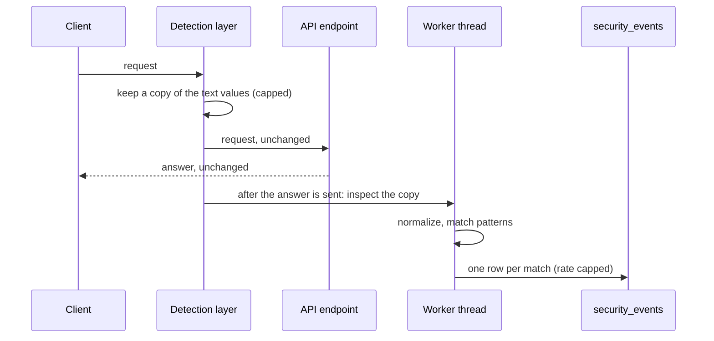

# Detection and the security page

- **Status:** design (next tier)
- **Related:** design workforce-ops-app/workforce-ops-backend#115, detection workforce-ops-app/workforce-ops-backend#116, security page workforce-ops-app/workforce-ops-frontend#61, tracker workforce-ops-app/.github#91; refused requests workforce-ops-app/workforce-ops-backend#92; method [decision 0030](https://github.com/workforce-ops-app/.github/blob/main/docs/decisions/0030-security-study-method.md); results go to the [research repository](https://github.com/workforce-ops-app/workforce-ops-research)

## In short
The API looks at the text people send it and notes anything that looks like an attack, such as SQL injection or a script tag, using regular expressions. It **only records what it saw; it never blocks a request**, because the real protection is how the application is built (bound parameters, safe rendering, permission checks). Owners and administrators see their company's records on a **security page**. The same detector is measured offline on public attack collections and tricky harmless text, which answers research question RQ1: what kinds of attack can pattern matching detect reliably?

## Who can use it

| Role | Can | Permission | Scope |
|---|---|---|---|
| Owner, Administrator | see the security page: their company's security events and counts per type | `security.view` | company |
| Manager, Employee | nothing; they never see security events, including their own | | |
| Platform staff | events from people who were not signed in (stretch: a cross-company view) | | platform |

`security.view` is a company-kind permission, so it needs a company-wide role assignment. The Owner and Administrator starting roles grant it; Manager and Employee do not ([authorization](../architecture/authorization.md#starting-roles)).

## How it works

1. A request arrives. The detection layer keeps a copy of the text the client sent: query string values, path values, and every string inside a JSON body, each with the name of the field it came from (for example `body.note`).
2. The request goes on to the endpoint **unchanged**. The answer goes back **unchanged**: a request that contains an attack string gets exactly the answer it would get without detection.
3. **After the answer is sent**, a worker thread inspects the copy, so detection never makes a request slower for the person who sent it.
4. Each value is **normalized** (decoded and simplified, see below) and checked against the patterns for each attack type.
5. Each match becomes one row in `security_events`, with the attack type, the pattern that matched, the field, and a short excerpt. If the sign-in check identified who sent the request, the row names that person and their company.
6. Owners and administrators open the security page to see their company's events, newest first, with counts per type.

---
## Details

### Attack types

The types agreed at the design review (#17, topic 7), plus format strings from the course topics ([threat model](../security/threat-model.md), I7):

| Type | Code | Typical sign | Course topic |
|---|---|---|---|
| SQL injection | `sql_injection` | quote followed by SQL keywords, `UNION SELECT`, `OR 1=1`, comment markers, stacked queries | SQL injection |
| Cross-site scripting | `xss` | `<script`, event handler attributes (`onerror=`), `javascript:` URLs, `<svg`/`` (for example `detection.xss`), `detection.summary` (DE6); later `authz.denied`, `csrf.refused`, `auth.lockout` (#92) |
| `pattern_id` | `VARCHAR(20)` | which pattern matched; null for non-detection kinds |
| `field` | `VARCHAR(100)` | where the value was, for example `query.search` or `body.note` |
| `method`, `route` | `VARCHAR(10)`, `VARCHAR(200)` | the route template (`/api/shifts/{shift_id}`), not the raw path |
| `client_address` | `VARCHAR(45)` | IPv4 or IPv6 (DE8) |
| `request_id` | `VARCHAR(40)` | links to the application log line for the same request (#92) |
| `excerpt` | `VARCHAR(200)` | plain text (DE7) |
| `count` | `INT` | 1, or how many events a summary row stands for |
| `occurred_at` | `DATETIME(6)` | UTC |

Kept for **1 year**, then removed by a nightly job (data model, retention). The application's database user may insert, read, and remove rows older than a year; it may not change them. Security events are **not** audit entries: they record what someone sent, not something the application did, and a flood of them must not grow the signed audit chain.

### Backend

| Method and path | Permission | What it does |
|---|---|---|
| `GET /api/security-events` | `security.view` | the company's events, newest first, paged (at most 200), filtered by `kind`, `user_id`, and a date range |
| `GET /api/security-events/summary` | `security.view` | counts per kind for the last 7 and 30 days |

There is no endpoint to change or remove events. Every read is filtered to the session's company by the tenancy layer, like every other table.

### Frontend

The security page (workforce-ops-app/workforce-ops-frontend#61): counts per type at the top, then the event list with filters. Each row shows the time, type, pattern, field, route, person (or "not signed in"), address, and excerpt. Every value is set with `textContent`.

### Audit and security

- Threats for the detector itself are in the [threat model](../security/threat-model.md): D4 (slow patterns), D5 (event flooding), T7 (attack text shown on the security page), I8 (secrets captured by detection), S6 (blaming another address), and R4 (evading detection).
- Security tests (`tests/security/`): a request with an attack string gets the same status and body as without (DE1); secrets are never stored (DE3); the caps hold (DE4, DE6); the excerpt survives as plain text (DE7); another company's events answer 404, and a Manager gets 403 (DE9).
- Reading the security page is not audited, like other reads.

### Known limitations

- **Detection can be evaded.** Pattern matching only sees known shapes of attack; a determined attacker can find a form that slips through (R4). That is acceptable because detection is a record, not a protection, and the study measures how much slips through.
- **Requests from people not signed in are not on any company's page** until the platform view exists (stretch).
- **Only text the API receives is inspected.** Attacks against nginx, or traffic that never reaches the API, are out of scope.

---
## Detection study (RQ1)

How the detector is measured for the report. The scripts, datasets, and results live in the [research repository](https://github.com/workforce-ops-app/workforce-ops-research), so the study can be repeated.

### Question and measures

**RQ1:** what types of attacks can pattern-based inspection of input detect reliably? For each attack type, on a test set the patterns were never tuned on:

| Measure | Meaning |
|---|---|
| Precision | of the inputs flagged as this type, how many really were |
| Recall | of the inputs that really were this type, how many were flagged |
| F1 | one number balancing the two |
| 95% confidence interval | Wilson interval for precision and recall, so a small set is not reported as more certain than it is |
| Confusion matrix | rows: the true type (or harmless); columns: the types flagged (or none). An input flagged as two types counts in both columns |
| False alarm rate on harmless input | the share of harmless inputs flagged as anything |
| Time per value | median and 99th percentile per pattern and for the whole detector |

"Reliably" is decided per type from these numbers and their intervals, and the report states the threshold it uses before the test set is scored.

### Data and how it is chosen

| Set | Source | Why |
|---|---|---|
| Attack input | [PayloadsAllTheThings](https://github.com/swisskyrepo/PayloadsAllTheThings) and [SecLists](https://github.com/danielmiessler/SecLists) (both MIT licensed), pinned to one commit each | widely used public collections, agreed at the design review; already labelled by attack type through their folder layout |
| Tricky harmless input | written by the team: names such as *O'Brien*, notes such as "please select a new shift", "I'll drop by at 5", "<3", "see ../notes", prices and times with `%` and `$` | false alarms are what make pattern matching look bad, so the harmless set is chosen to be hard, not easy |
| Ordinary harmless input | the demo data's text fields, and a public list of common surnames | the false alarm rate on everyday text, not only on tricky text |
| Field set | requests sent by ZAP, sqlmap, and Burp during the attacker audits (backend #118, #119), labelled by the tool's attack category, plus a scripted walk-through of the final demo as harmless traffic | checks the numbers on traffic the patterns were not built from |

**Selection rules,** written down before anything is scored:
1. Take every entry from the files for each type at the pinned commits. Leave out entries that need a different setting to be dangerous (binary data, attacks on other protocols), and record each excluded file with the reason.
2. Remove duplicates after normalization, and keep near-duplicates (equal after removing digits and whitespace) together in one set, so the test set is not just copies of the tuning set.
3. If a type has more than 1,000 entries, take a random sample of 1,000 with a fixed seed, so one large type does not dominate.
4. Target at least 300 test entries per attack type and 1,000 harmless test entries, which keeps the confidence intervals within about 3 to 6 percentage points.

### Tuning and test split

- Each type's entries are split **60% tuning, 40% test**, stratified by type and by source, with a fixed seed.
- The split is committed, with each file's SHA-256 checksum, **before any pattern is tuned**. Nobody looks at the test set while writing patterns.
- When tuning ends, the detector is tagged (for example `detector-v1`) and scored on the test set **once**. A later change is a new version with its own score; the first score stays in the report.
- The field set is scored with the same tagged version.

### Timing

- Each value is matched 100 times and the median is kept, using `time.perf_counter_ns`, on one stated machine with nothing else running.
- **Worst case:** for each pattern, crafted inputs at the 2,000 character cap (long runs of characters that almost match) must finish within a fixed budget per value (DE5). This doubles as the safety check against slow patterns, and runs as a test in CI.
- The time detection adds to the server's work per request is measured with and without the detection layer on the same requests.

### Threats to validity (for the report)

- **The test data comes from public collections,** which may over-represent attacks that are easy to spot. The field set and the tricky harmless set are there to check this.
- **The team wrote both the patterns and the tricky harmless set.** The harmless set is written and committed before tuning starts, so it cannot be chosen to fit the patterns.
- **Lab conditions:** timing comes from one machine, and the field set comes from our own audits, not real attackers.
- **Labels follow the collections' folders,** which are sometimes wrong or overlap; disagreements found while checking are recorded, not silently fixed.

---
## Slices

Filed under tracker workforce-ops-app/.github#91 once this design merges. Each is one pull request.

| ID | Repository | Slice | Depends on |
|---|---|---|---|
| DT1 | backend | this design page (#115) | |
| DT2 | backend | `security_events` table, writer with the rate cap (DE6), and the yearly clean-up job | DT1 |
| DT3 | backend | the detector module: normalization, patterns, unit tests, and the worst-case timing test (DE4, DE5, DE10) | DT1 |
| DT4 | backend | the detection layer: copy values, inspect after the answer, record events (DE1 to DE3, DE7 to DE9) | DT2, DT3 |
| DT5 | backend | `security.view` permission and the two endpoints | DT2 |
| DT6 | backend | security events in the demo data | DT2 |
| DT7 | frontend | the security page (#61) | DT5 |
| DS1 | research | fetch the datasets at pinned commits, apply the selection rules, write the split with checksums | DT1 |
| DS2 | research | the scoring script with tests: precision, recall, F1, intervals, confusion matrix, timing | DS1, DT3 |
| DS3 | research | score the tagged detector on the test set and the field set; publish the results | DS2, DT4, backend #118, #119 |
