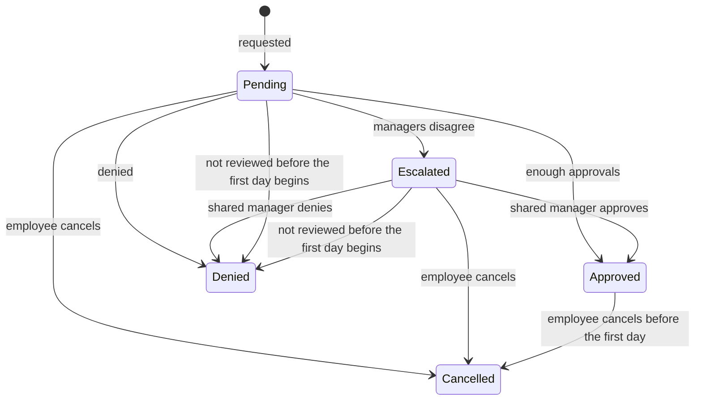

# Time-off requests

- **Status:** built (core tier): asking, cancelling, and following requests (TO1, #63, migration `0012`); reviewing, escalation, and opening shifts (TO2, #64). Code in `app/modules/time_off/`
- **Related:** workforce-ops-app/workforce-ops-backend#10; frontend page: time-off screens (workforce-ops-app/workforce-ops-frontend#3); design: [authorization](../architecture/authorization.md), [data model](../architecture/data-model.md#approval_requests), [schedules](schedules.md)

## In short
Employees ask for days off. The request goes to the people they report to directly, who approve or deny it. If those managers disagree, the request moves up to the nearest person above all of them, whose decision settles it. Nobody reviews their own request. When a request is approved, the employee's shifts on those days become open so a manager can give them to someone else.

## Who can use it

| Role | Can | Permission | Scope |
|---|---|---|---|
| Everyone | ask for time off; cancel their own request | `time_off.request_self`, `time_off.cancel_self` | own requests |
| Manager | see requests of people in scope; approve or deny the requests of people they are above | `time_off.view`, `time_off.review` | their scope; reviews also need a position above the employee |
| Owner, Administrator | the same, company-wide | `time_off.view`, `time_off.review` | company; reviews still need a position above (the Owner is above everyone) |

## How it works

```mermaid
sequenceDiagram
    participant E as Employee
    participant A as API
    participant M as Direct managers
    participant N as Nearest shared manager
    E->>A: request days off
    A->>A: find reviewers in the reporting chain
    A-->>M: request waits on their review page
    M->>A: approve / deny
    alt enough approvals, no denial
        A->>A: approved; affected shifts become open
    else a denial, no approval
        A->>A: denied
    else managers disagree
        A-->>N: request moves up
        N->>A: approve / deny (settles it)
    end
    A-->>E: status shown on their page
```

1. The employee picks the first and last day and may add a short reason. The request shows which of their shifts fall on those days.
2. It goes to their **direct managers** who hold `time_off.review`. If none of them can review it (or the employee has no manager), it moves up the chain until someone can, ending at the Owner ([0029](https://github.com/workforce-ops-app/.github/blob/main/docs/decisions/0029-request-approval-routing.md)).
3. Reviewers see the request, its affected shifts, and the other reviewers' decisions. Someone higher in the chain decides only once the request moves up to them (agreed 2026-11-19 for the final: letting anyone higher step in at any time would need its own rule for how their decision combines with the others').
4. When it is approved, the employee's shifts on those days become **open**. The manager can give them to someone else before or after the decision ([schedules](schedules.md)).
5. The employee can cancel their request until its first day.
6. **Same-day absences** (for example calling in sick that morning) are not time-off requests: the manager makes that day's shifts open on the schedule, which is audited ([schedules](schedules.md)).

In the core tier, requests and their status are shown on the pages; notifications come with the next tier.

---
## Details

### States and rules



- **Whole days only**, from a first to a last day (at most 30 days per request), stored as `DATE` in the employee's workplace zone ([0021](https://github.com/workforce-ops-app/.github/blob/main/docs/decisions/0021-time-handling.md)). The first day is **tomorrow or later**, so every request can be reviewed before it starts.
- **No overlap:** a new request may not overlap the employee's own pending, escalated, or approved requests (409).
- **Required approvals:** a company setting, `time_off.required_approvals`, default **1** (a company may choose 1 to 5, never 0, declared in `app/modules/time_off/settings.py`), counted among the direct managers ([company settings](../architecture/data-model.md#company_settings)). If fewer direct managers can review than required, all available direct managers are required instead. Telling administrators that the setting does not fit their reporting lines comes with notifications (next tier).
- **Outcome among direct managers:**
  - enough approvals and no denial: **approved**;
  - denials and no approval: **denied**;
  - both approvals and a denial: **escalated** to the **nearest shared manager**, the lowest person above all of the managers who decided. That person's decision settles it; with several equally near, the first decision settles it; with none, the Owner decides. Nearest means the fewest steps up to the farthest of the managers who decided, and the shared manager must hold `time_off.review` over the employee. Nobody who already decided reviews it again; if that leaves nobody (an owner was one of the managers who disagreed, and there is no other owner), it waits until it is declined as not reviewed.
- **No self-review:** nobody reviews their own request; a manager's request goes to their own managers.
- **Reviewers are checked at the moment they decide** (still above the employee, still holding `time_off.review`).
- **On approval:** every shift of the employee that overlaps the approved days becomes **open** (`employee_id` cleared, status `open`), with an audit entry linking it to the request.
- **While approved,** nobody can give the employee a shift on those days again (409; [schedules](schedules.md#states-and-rules)).
- **Cancelling an approved request** does not give the shifts back automatically; the manager reassigns them.
- **Not reviewed in time:** a request still undecided (pending or escalated) when its **first day begins** (midnight in the employee's workplace zone) is **declined**. It counts as declined for everything, and the audit log records that nobody reviewed it; the employee sees "Declined: not reviewed in time". Role grants, owner changes, and account changes use a 7-day deadline instead ([0032](https://github.com/workforce-ops-app/.github/blob/main/docs/decisions/0032-delegation-limits.md)).
- **Next tier:**
  - **Advance notice**, company setting `time_off.min_notice_days` (default 0): how many days before the first day an employee must ask.
  - **Decision deadline**, company setting `time_off.decision_deadline_hours` (default: none, which keeps the start-of-first-day rule): how long before the first day reviewers must decide. When it passes undecided, the request either is declined as not reviewed or moves up the chain to the next person above; which of the two is decided when the next tier is designed.
  - Reminders to reviewers, and notifications.
  - Attachments (for example a doctor's note) are stretch.

### Backend

**Endpoints** (under `/api`, [0026](https://github.com/workforce-ops-app/.github/blob/main/docs/decisions/0026-api-conventions.md)):

| Method and path | Permission | Does |
|---|---|---|
| `GET /time-off-requests?mine=true` | `time_off.request_self` | your own requests |
| `GET /time-off-requests?status=&employee_id=&from=&to=` | `time_off.view` (scope filter) | requests of people in scope |
| `GET /time-off-requests/waiting` | signed in | requests waiting for your review; once you approve or deny one, it leaves this list even while it still waits for other reviewers |
| `GET /time-off-requests/{id}` | owner of the request, or `time_off.view` | one request, with its affected shifts and decisions so far |
| `POST /time-off-requests` `{first_day, last_day, reason}` | `time_off.request_self` | ask for time off |
| `POST /time-off-requests/{id}/cancel` | `time_off.cancel_self` | cancel your own request |
| `POST /time-off-requests/{id}/approve`, `POST /time-off-requests/{id}/deny` `{comment}` | `time_off.review`, above the employee | decide |

Every answer names the employee (`employee_name`), and each decision its reviewer (`approver_name`), so the review screen needs no lookups the reviewer may not be allowed to make (#172). Names are read in one query per answer. Anyone who may see a request may see these names.

**Progress of an open request:** while a request is pending or escalated, every answer about it also carries `progress`: `decided` (each reviewer who has decided so far, with `approver_name` and `decision`, oldest first) and `waiting_for` (the reviewers who still have to, by `display_name`, worked out as for a decision, without anyone who already decided or is deactivated). Once the request is settled, `progress` is `null`. A request needing several reviewers waits for all of them, so after one denial it is still pending; the screens use `progress` to say so ("You declined. Waiting for Felix Grant.") instead of reading as untouched. Found in review (2026-11-20). The employee already saw these decisions on the request itself; comments stay on the request page only.

**Table: `time_off_requests`** (feature table; the shared approval tables are on the [data model](../architecture/data-model.md#approval_requests) page)

| Column | Type | Rules |
|---|---|---|
| `id` | `BINARY(16)` | primary key |
| `company_id` | `BINARY(16)` | required |
| `employee_id` | `BINARY(16)` | required; company-aware foreign key to `users` |
| `first_day`, `last_day` | `DATE` | required; `CHECK (last_day >= first_day)`; in the employee's workplace zone |
| `reason` | `VARCHAR(500)` | optional; shown as plain text |
| `status` | `VARCHAR(12)` | `pending`, `escalated`, `approved`, `denied`, or `cancelled`; a request declined because nobody reviewed it is `denied`, and its approval record has `not_reviewed` set |
| `approval_request_id` | `BINARY(16)` | required; company-aware foreign key to `approval_requests` (kind `time_off`) |
| `decided_at` | `DATETIME(6)` | null until approved, denied, or cancelled |

| From | To | How many | Enforced by | Meaning |
|---|---|---|---|---|
| users | time_off_requests | one to many | company-aware foreign key | A person can ask for time off many times |
| time_off_requests | approval_requests | one to one | company-aware foreign key, unique | Each request has one approval record holding its decisions |

**Approval record:** kind `time_off`; `required_approvals` from the company setting; decisions in `approval_decisions`. When the request escalates, the payload records the nearest shared manager(s), and their decision settles it (this kind's own rule instead of "any denial denies").

**Scope resolver:** a request belongs to its employee, and through them to their home department and teams.

**Not reviewed in time, without a background job** (agreed 2026-11-19 for the final; see [authorization](../architecture/authorization.md#approval-request-endpoints)): the approval record's deadline (`review_by`) is the start of the first day in the employee's workplace zone. The first read or action on a request after that moment declines it as not reviewed (actor `system`, `decided_at` = the deadline itself), through the shared approval layer and the time-off handler's `lapsed` hook (`app/modules/time_off/approval.py`). Every list and view does this first, so the answer never shows a stale status, and no decision can arrive late. A scheduled job can replace it later without changing any endpoint.

**In the code:** rules for asking, cancelling, and deciding in `app/modules/time_off/service.py`; who reviews and what the decisions add up to in `review.py` (the shared layer calls it through the handler's `outcome` hook, instead of its own "one denial denies"); the approval record's hooks in `approval.py`; days and time zones in `days.py`; where a request belongs (its employee) in `scope.py`. A decision locks, in order, the company's reporting lines, the employee, the request, its approval record, and the shifts it opens, and only then writes audit entries: the same order as every schedule change, so the two never wait on each other. For that reason time-off requests are decided only on their own endpoints; `/api/approval-requests/{id}/approve` answers 409 for them. Reviewers' comments are kept with the approval record (plain text, at most 500 characters) and never in the audit log. Each person's requests take turns through a lock on their user row, so two requests sent at once cannot both pass the overlap check. The reason never goes into the audit log, which is kept for good.

### Demo data

Built in SD2 as `DEMO_TIME_OFF` in `scripts/seed_demo.py` (workforce-ops-app/workforce-ops-backend#68), the same in both companies (in Northwind Cafe; days counted from the day the script runs):

| Who asks | Days | Reason | Afterwards | State |
|---|---|---|---|---|
| Ella Novak | day 1 | Doctor's appointment | nobody reviews it (only the owner could: she has no manager) | waiting; declined as not reviewed from day 1 on |
| Diego Ruiz | day 4 | Concert | declined by Priya Shah, with a comment | declined |
| Ella Novak | day 5 | | cancelled by Ella | cancelled |
| Ben Okafor | days 6 and 7 | Moving house | denied by Felix Grant, approved by Ana Diaz (his two managers) | moved up to Marcus Lee, the nearest manager above both |
| Cara Lund | days 8 to 10 | Wedding | approved by Felix Grant, with a comment | approved; her shift on those days is open |
| Diego Ruiz | days 10 and 11 | Family visit | | waiting for Priya Shah |

Each step (asking, each decision, cancelling) goes through this module's service as the person who takes it, exactly as on the website, so the same rules apply: only a current reviewer decides (worked out from the [reporting lines](organization.md#demo-data)), approving opens the shifts on those days with their `shift.opened` entries, and everything is audited under that person's name. The days count from the real today, since the application refuses days that have started, and the requests come right after the shifts (which they wait for). Added once per company; a step the application refuses stops the script and keeps none of that company's requests (`tests/unit/test_seed_demo.py`, checked also against MySQL).

### Audit and security

**Audit events:** `time_off.requested`, `time_off.approved`, `time_off.denied`, `time_off.escalated` (details: who it went to), `time_off.cancelled`, `time_off.not_reviewed` (actor `system`; the request is declined), and `shift.opened` for each shift opened by an approval (details: the request).

**Threats** ([threat model](../security/threat-model.md)): E5 (approving your own request), E3 (reviewing someone you are not above), I1 and I2 (seeing others' requests), T2 (setting the status directly), T5 (reason text).

**Security tests:**
- Nobody can approve or deny their own request, even with `time_off.review` (AZ7).
- A manager who is not above the employee cannot review, even with the permission and scope.
- Disagreement escalates to the nearest shared manager; with no shared manager, to the Owner.
- An employee cannot see other people's requests without `time_off.view` in scope; other companies' requests answer 404.
- Approval opens exactly the overlapping shifts, and nothing else.

### Known limitations
- Whole days only; no part-day requests.
- No notifications in the core tier; reviewers check their page.
- Cancelling an approved request leaves the opened shifts open.
